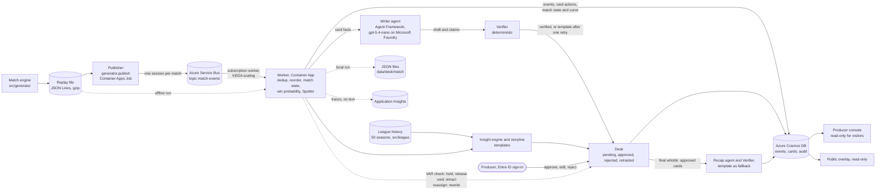

# Watershed

Football's fine margins, measured live and explained to you.

> **For judges.** Watershed is an editorial desk for live football graphics on Microsoft Foundry, Microsoft Agent Framework and Azure Container Apps; target category: Best Enterprise Solution.
> - **Live demo:** [read-only judge view, no sign-in](https://ca-web-ob4grgftye7tm.happyocean-d5f87e00.swedencentral.azurecontainerapps.io); add `/overlay` for the lower-third as it would air.
> - **What to look at:** the 63' goal card, written by the model, verified number by number, put on air, then retracted when VAR ruled the goal out, with its audit trail ([How to test](#how-to-test), about 4 minutes).
> - **Video:** [VIDEO URL]. **Project page:** [PROJECT PAGE URL].
> - **Run it locally:** Python 3.12, no Azure and no model call: [How to test, locally](#locally-no-azure-needed).

Watershed is an editorial desk for live football broadcasts. It reads a match event feed as it arrives, measures how far each key moment moves the win probability, and has an Agent Framework agent that calls gpt-5.4-nano on Microsoft Foundry write the reason in English, French and Spanish, with every number checked against the data by code. A producer approves each card (the on-screen graphic of a moment) before it goes on air, and the desk retracts or rewrites a card when the feed changes its mind (a VAR overturn, a goal credited to another player).

Watershed works alongside human commentators: with each card it suggests a few lines for the commentary team, written for two fictional voices. It writes text only; nothing is voiced.

All match data is synthetic, produced by the match engine in this repository. No real match, club, player, footage or logo is used.

## What exists today

| Part | State | Where |
|---|---|---|
| Synthetic match engine, ground truth, Common Data Format export | Done, tested | `src/generator/` |
| Win-probability model (Skellam, with expected added time) behind a replaceable interface | Done, tested | `src/winprob/` |
| Worker: deduplication, reordering, match state, Spotter, card actions on corrections | Deployed in Azure Container Apps, scaled from zero by KEDA on the Service Bus subscription; tested offline | `src/worker/match.py`, `spotter.py`, `pipeline.py`, `azure_io.py` |
| Writer agent (Agent Framework, gpt-5.4-nano on Microsoft Foundry), deterministic Verifier, approval desk with audit trail | Deployed; measured on the reference replay of 26/10 (below) | `src/worker/writer.py`, `desk.py` |
| Recap at the final whistle: the recap agent (same model) writes it when its draft passes the Verifier, the template otherwise | Deployed; on the reference replay the template wrote it | `src/worker/recap.py` |
| Desk data contract: cards, match state with the win-probability curve, insights, storyline, recap, audit trail, in Cosmos DB or in local JSON files | Done | `docs/contracts.md`, `src/worker/pipeline.py` (`JsonFileSink`, `match_state`) |
| Infrastructure as code (azd and Bicep): Service Bus, Cosmos DB, Container Apps, Container Registry, Log Analytics, Application Insights, one managed identity per app, Easy Auth | Deployed; the Foundry project and its model deployment are created separately | `infra/` |
| Demo replay as a Container Apps Job, and a reset of one match between two replays | Deployed | `infra/resources.bicep`, `src/generator/publish.py`, `src/worker/reset.py` |
| Producer console and public overlay: read-only view without sign-in, producer actions behind Easy Auth (Microsoft Entra ID), per-IP rate limit | Deployed | [`src/web/`](src/web/) |
| Traces of each draft and each model call in Application Insights (OpenTelemetry), without prompt or reply text | Deployed | [`src/worker/telemetry.py`](src/worker/telemetry.py) |
| Evaluation against the hidden ground truth: 100 unscripted matches and the demo | Done | [`docs/evaluation.md`](docs/evaluation.md), `src/worker/evaluate.py` |
| Producer feedback (thumbs, reasons, notes): stored, measured, exported; read back into the Writer prompt when `FEEDBACK_PROFILE` is set | Built; online it is stored and measured, not read back by the worker | [`src/worker/feedback.py`](src/worker/feedback.py), [`docs/notes/feedback.md`](docs/notes/feedback.md) |
| Pitch figures from the 360 frames, including the 63' offside frame with the offside line | Built | [`src/web/pitch.py`](src/web/pitch.py), [`docs/img/`](docs/img/) |
| CI (tests, Bicep build, both images built and their imports checked, secret scanning), Dependabot | Done | [`.github/`](.github/) |
| Cost kill switch tied to the budget, which leaves the read-only web app up | Built and tested against fakes of the Azure API; not deployed | [`infra/killswitch/`](infra/killswitch/) |
| Fictional league history: 50 seasons, 32 clubs with promotion and relegation, about 4,000 players with careers, 19,000 matches with scorers, substitutions and cards | Done, tested | [`src/league/history.py`](src/league/history.py), [`docs/notes/history.md`](docs/notes/history.md) |
| Insight engine: facts that surface live (a substitute's hat-trick, a comeback, a half-time lead lost), ranked by how rare they are in the history, updated or withdrawn as the match goes on, and a stat of the match at full time; written from checked templates | Done, tested | [`src/worker/insights.py`](src/worker/insights.py), [`docs/notes/insights.md`](docs/notes/insights.md) |
| Storyline: table, relegation stakes, form and head-to-head before kick-off; what the result changed after it | Done, tested | [`src/worker/storyline.py`](src/worker/storyline.py) |
| Commentary duo: two fictional commentators, in three languages, with a per-match memory against repetition | Deployed: the model writes the lines with each card; templates write the lines on a VAR ruling | [`src/worker/duo.py`](src/worker/duo.py), [`docs/notes/duo.md`](docs/notes/duo.md) |
| Agents and MCP: a read-only MCP server over the desk and the league history, the Writer reading its facts through it, and an optional commentary duo by two agents in an Agent Framework GroupChat | Built and tested offline with scripted models, behind options; not in the deployed image | [`src/worker/mcp_server.py`](src/worker/mcp_server.py), [`src/worker/duo_agents.py`](src/worker/duo_agents.py), [`docs/notes/agentic.md`](docs/notes/agentic.md) |
| Match graphics (shot map, goal build-ups, animated set pieces, momentum) and tactical details from the 360 frames | Built | [`src/web/graphics.py`](src/web/graphics.py), [`src/worker/tactics.py`](src/worker/tactics.py) |

**Live run, 26/10/2026, in Azure.** The reference replay of the demo match went through the deployed pipeline in judging mode (auto-approve): the model wrote all 12 card writes (11 cards and one rewrite), 11 verified at the first attempt and 1 at the second; the recap agent's two drafts failed the Verifier (numbers without a claim, then an invalid reply) and the template wrote the recap. 15 model calls of the 40 allowed per match, no HTTP 429, 24.4 s per card attempt at the median (31.5 s at p95), 139,586 input and 42,044 output tokens for the cards. Measures in [`docs/evaluation.md`](docs/evaluation.md#live-run-production-prompt) ("Live run, production prompt"), documents as stored in [`docs/samples/`](docs/samples/).

## How to test

### Online (about 4 minutes, no sign-in)

**Live demo:** https://ca-web-ob4grgftye7tm.happyocean-d5f87e00.swedencentral.azurecontainerapps.io. No sign-in needed: the page opens in a read-only view. The "Producer sign-in" link is for the project's producer account; you can ignore it. The demo match was replayed once through the deployed pipeline in judging mode, where verified cards go on air without a click, so the console shows the match as it ended. A desktop browser works best.

1. Open the live demo. Expected: "Watershed producer desk", "Read-only view", the score Varleigh 5-2 Yarnford with "FT", and three views: "Desk", "All graphics" and "All insights and storyline". On the left, the "Rundown" lists the 11 cards of the match in match order.
2. In the Rundown, pick the 63' goal card. Expected: "Retracted on air", "VAR decision: Offside, tight call" and "The lower-third said: Goal ruled out (VAR, offside)"; under "On the VAR ruling", the lines suggested to the commentators; then the English text (the language switch shows French and Spanish; console labels stay in English) and one summary line: "Verified", every number traced to a fact, the writer, the time the model took, "retracted on air (VAR offside)". On the right, under the win-probability curve, the build-up of this goal and the insights on this moment.
3. Scroll down the same card. Expected: "Suggested lines" (proposed text for the commentary team, never voiced); open "Where each number comes from": each number with its fact and what the fact means; open "Verification and history": "Verifier: passes", the writer `gpt-5.4-nano` and the model attempts, then written, approved by auto-approve, held for a VAR check by the feed, retracted by the feed; on the win-probability curve, this goal drawn as a cross.
4. Press "Play" next to "Replay the match" in the header: the match plays back in about 48 s, cards appearing at their minute, the score and the curve following; at 63' the goal goes on air with a "VAR check" badge, at 64' it shows "Retracted on air". Drag the slider to its right end to come back to full time.
5. Pick the 31' goal card. Expected: version 2, "Scorer corrected" with both players, and "Rewrite requested" in its history.
6. Open "All insights and storyline". Expected: the facts of the match with their rarity told in seasons (at 83', a first in 50 seasons), the pre-match storyline with the relegation stakes, and under "After the match" the recap, the supporters' text and the analyst's text in English, French and Spanish.
7. Open "All graphics". The first menu shows "Shot map": the two goals VAR ruled out are purple crosses, left out of the totals. Choose "Tactical details", then the 63' run in the second menu: the pass with the offside line.
8. Open `/overlay` on the same address, then FR and ES. Expected: the score with "FT" and the last lower-third of the match with its "auto-approved" tag, in each language, with no producer control.

**What to look for:** every number in a text is listed with the data field it comes from; the two goals VAR ruled out (63', 69') are marked "Retracted on air"; nothing can be approved without signing in.

### Locally (no Azure needed)

Python 3.12 or later (`python3` on macOS or Linux).

```
git clone https://github.com/akyuzdilhan/watershed.git
cd watershed
python -m venv .venv
.venv\Scripts\activate                     # Windows; on macOS or Linux: source .venv/bin/activate
pip install -e ".[azure,agents,agentic,web,dev]"
python -m league history --seed 9 --seasons 50 --out data/history
python -m worker data/replay/demo-0007.jsonl.gz --truth data/replay/demo-0007.truth.json --writer template --auto-approve --desk-dir data/desk --history data/history/9 --league-seed 9
python -m web.app                          # keeps running; stop it with Ctrl+C
pytest                                     # optional, about 5 minutes
```

1. `league history` writes the 50 seasons of the fictional league to `data/history/9` in under 10 seconds ("History of seed 9: 1976/77 to 2025/26, 19000 matches, 4000 players").
2. `worker` replays the demo match offline with the template writer, so no model is called (about 10 seconds). It prints the 11 cards in English, French and Spanish, a hold then a retract on the 63' and 69' goals, the rewrite of the 31' goal at 33', the facts of the insight engine, the recap in three languages, the final score 5-2, and a report against the ground truth with `"recall": 1.0`, `"precision": 1.0` and `"card_actions_correct": true`. It writes the desk, recap included, to `data/desk/demo-0007/`.
3. `web.app` serves the console at http://127.0.0.1:8050 and the overlay at http://127.0.0.1:8050/overlay. Locally you are the producer: open the 66' goal card, click Edit, change a number and approve the edit: the Verifier refuses it.
4. `pytest` runs the 726 tests without Azure and without model calls.

To replay the match again, first clear its desk: `python -m worker.reset --match demo-0007 --desk-dir data/desk --yes` (the worker appends to the audit trail). To write with the model instead of the templates, add `--writer foundry` and set `FOUNDRY_PROJECT_ENDPOINT` and `FOUNDRY_MODEL` in `.env` (see `.env.example`), with an `az login` account allowed to call the Foundry project; that calls the model up to 40 times for the match. `python -m worker.recap data/desk/demo-0007` writes the recap again on its own.

### Agents and MCP (optional, local)

Three pieces sit behind options of the worker, off by default; without them the worker does not import them and writes the same outputs byte for byte. They need the `agentic` extra (`pip install -e ".[azure,agents,agentic,dev]"`), which the deployed image does not install, so the deployed demo runs without them.

- **The desk's MCP server**, `watershed-desk` (`src/worker/mcp_server.py`): seven read-only tools, the facts of a card (`get_moment`), the match so far, the pre-match storyline, and the league history (a player, a club, head-to-head, the last time something happened). Any MCP host can open it on stdio over a folder the worker wrote: `python -m worker.mcp_server --desk-dir data/desk --history data/history/9`.
- **The Writer through MCP** (`--writer foundry --facts mcp`): the Writer reads `get_moment` from that server instead of its local tool, with the same message, Verifier, retry and budget, and falls back to the local tool if the connection cannot open.
- **The duo by two agents** (`--duo agents`): Wren and Joss as two Agent Framework agents in a GroupChat whose running order is set by code, each with its own MCP tools. They run after the card is on the desk with its template duo, off the card's path, each turn checked by the Verifier before the other agent hears it. Their lines replace the template duo only when the whole exchange passes; otherwise the template duo stays and the audit says why. The lines remain text suggestions for the human commentators.

Offline, with a scripted model for Wren and Joss (no Azure, no cost):

```
python -m worker data/replay/demo-0007.jsonl.gz --writer template --duo agents --duo-dry --history data/history/9 --league-seed 9 --desk-dir data/desk
```

Each eligible card then prints a line such as `duo agents:dry: wren, joss (player_history), wren, joss: 4 runs, 0.2 s`, and the run ends with `duo agents (dry): 9 written, {} template, 27 of 36 runs`. The duo has a budget of its own (`--duo-calls`, 36 runs per match), apart from the Writer's 40. Design, budget, latency and what is not yet verified against the real model: [`docs/notes/agents.md`](docs/notes/agents.md); fields and tools: [`docs/contracts.md`](docs/contracts.md#agents-and-mcp-behind-options).

## Why it matters

A broadcast graphic that says "Yarnford equalise" and stays on screen after VAR rules the goal out is an error the audience sees live. Feeds correct themselves all the time: goals are voided, scorers are reassigned after a deflection, actions arrive late or twice. A system that writes on-air text from a feed has to treat those corrections as normal traffic, keep a person in charge of what airs, and never let a language model invent a number. Watershed is built around those three constraints:

- **Every number comes from code.** The win probabilities, the swing and the value of a chance are computed deterministically; the model only writes sentences and must declare, for each number, the field it took it from. A deterministic Verifier rejects anything else.
- **A producer decides what airs.** Cards wait in `pending` until approved, edited or rejected; every step is in the audit trail. An auto-approve mode exists for unattended judging: each such approval is recorded as `auto-approve` in the audit trail and the lower-third shows "auto-approved".
- **Corrections are first-class.** A VAR check holds the card, a voided goal retracts it (and records whether it had already aired), a reassigned goal rewrites it as a new version.

"Points" in every text means percentage points: the gap between two chances of winning.

## The demo match

Seed 7, story `demo`: Varleigh (home) against Yarnford, both fictional. The committed replay is `data/replay/demo-0007.jsonl.gz` and its hidden ground truth `data/replay/demo-0007.truth.json`. The win probabilities below are those of the cards, from the local `worker` command of [How to test](#locally-no-azure-needed) (deterministic, no Azure needed).

| Minute | What happens in the feed | What the desk does | Card figures |
|---|---|---|---|
| 14' | Yarnford #9 scores | Goal card | Yarnford 30% → 58% to win |
| 31' | Yarnford goal credited to #10; at 33' the provider reassigns it to #7 (deflection) | Card rewritten as version 2 with the new scorer | Yarnford 60% → 84% |
| 41' | Yarnford #5 booked | No card (a yellow card does not move the result probabilities) | |
| 46' | Varleigh 0-2 at half-time bring on #20 for #9 | | |
| 52', 57' | #20 scores twice: 2-2 | Two goal cards | Varleigh 2% → 10%, then 8% → 32% |
| **63'** | **#20 scores again. The card goes on air. A VAR check starts 15 seconds later; at 64' the goal is ruled out for a tight offside, visible in the freeze frame of the through ball** | **Card held during the check, then retracted, flagged as retracted on air** | Varleigh 29% → 78%, withdrawn |
| 66' | #20 scores anyway: 3-2 | Goal card | Varleigh 28% → 79% |
| 69' | Yarnford equalise; VAR rules it out for handball at 70' | Card held, then retracted | Yarnford 3% → 20%, withdrawn |
| 72' | Varleigh's keeper saves a Yarnford shot at 3-2 | Save card that credits the keeper, not the shooter | Varleigh kept at 81% instead of 24% if it had gone in |
| 78' | Yarnford #5 gets a second yellow | Red-card card | Yarnford 2% → 1% with ten men |
| 83' | #20's fourth goal | Goal card | Varleigh 91% → 99% |
| 88' | Varleigh #10 scores; VAR check; the goal stands | Card held, then released | 99%, never 100% before the final whistle |

Final score 5-2. Against the ground truth, the worker finds all 11 moments that deserve a card, produces no extra card, and takes exactly the three expected card actions (one rewrite, two retractions) (`tests/test_worker.py`). The feed also carries 13 duplicated and 32 delayed messages, which the worker absorbs.

## Story, history and the commentary duo

Every number a viewer sees is anchored to something they can picture. The desk compares the match in progress with 50 fictional seasons of the same league and says what makes it unique, for whom, in seasons rather than in match counts:

| When | What airs (French texts and duo, from the template writer) |
|---|---|
| Before kick-off | "Varleigh - Yarnford, duel pour le maintien": Yarnford are on 34% to go down, 16% with a win, 43% with a defeat. Wren: "Varleigh 17e, Yarnford 18e. Ce soir, on joue le maintien, Joss." |
| 66' | "Seulement le 6e triplé d'un remplaçant en 50 saisons, le premier depuis Tino Höglund en 2021/22." |
| 83' | "Premier quadruplé d'un joueur entré en cours de match en 50 saisons de championnat." Joss: "Jamais, Wren. En 50 saisons, aucun joueur entré en cours de match n'avait marqué 4 fois." |
| Full time | "Première défaite de Yarnford à l'extérieur après avoir mené à la pause depuis 2020/21, il y a 6 saisons." Stat of the match: the substitute's four goals, ranked first by rarity. |
| Recap | Names both goals VAR ruled out and why ("hors-jeu d'un rien", "main"), and what the result changed: "Après la journée, Varleigh est 16e (17e avant le match), et ce résultat fait passer son risque de descente de 11 % à 4 %." |

Offside margins stay off air: on air an offside is only called tight or clear, in words. The margin is measured and kept for the signed-in producer; the console never shows it to visitors, and the overlay never shows it.

The two commentators, Wren Calder (the emotion and the story) and Joss Ferrier (the number and the detail), are fictional and imitate no real person.

## Architecture



1. The engine writes a match as a feed of JSON messages with a common envelope (schema version, message id, provider sequence number, broadcast clock) and a hidden ground truth.
2. The publisher replays the feed on a Service Bus topic, with the match id as session id so one receiver gets a match in order. Key moments play in real time, the rest faster, so a card can air before the feed corrects it.
3. The worker deduplicates by message id, restores provider order with a 3-second buffer, derives the match state from the set of messages (so a late or repeated message cannot corrupt it), computes the win probability before and after each action, and lets the Spotter decide which moments deserve a card.
4. The Writer agent gets the facts of a card through a function tool and writes it in English, French and Spanish with the suggested lines; the Verifier checks every number; the desk stages the card for the producer and writes everything to Cosmos DB, with a match-state document that carries the score, the clock and the win-probability curve (or to JSON files in `data/desk/<match_id>/` when run locally).
5. Against the league history, the insight engine proposes facts and the storyline sets the stakes; both are written from templates and go through the same desk.
6. A VAR check or a correction in the feed becomes an action on the card already proposed or on air.
7. At the final whistle, the recap agent writes a match report, a supporters' text and an analyst's text from the approved cards only; the template writes them when its drafts fail the Verifier.

Details, message types, the temporal contract of corrections, identities and failure modes: [`docs/architecture.md`](docs/architecture.md). What the console and the overlay read: [`docs/contracts.md`](docs/contracts.md).

## Microsoft and Azure technologies

| Technology | Role | Where |
|---|---|---|
| Microsoft Foundry | Hosts the `gpt-5.4-nano` deployment (GlobalStandard) that both agents call with Entra ID tokens; reasoning effort `medium` for the cards, `low` for the recap | [`src/worker/writer.py`](src/worker/writer.py) (`FoundryWriter`), [`src/worker/recap.py`](src/worker/recap.py) (`RecapWriter`), [`.env.example`](.env.example) |
| Microsoft Agent Framework | Two Agent Framework agents in the worker, each calling the model through the Foundry project endpoint (Responses API): the Writer, with the `get_moment` function tool, and the recap writer, with `get_recap_facts`; a trial in `spikes/` runs Spotter, Writer and Verifier as a workflow with a human approval pause (`request_info`) | [`src/worker/writer.py`](src/worker/writer.py), [`src/worker/recap.py`](src/worker/recap.py), [`spikes/af_trial.py`](spikes/af_trial.py) |
| Azure Container Apps | The web app (console and overlay, 0 to 2 replicas); the worker, scaled from zero by a KEDA rule on the Service Bus subscription; the demo replay as a Container Apps Job | [`infra/resources.bicep`](infra/resources.bicep), [`src/web/`](src/web/), [`src/worker/Dockerfile`](src/worker/Dockerfile) |
| Azure Service Bus | Transport: topic `match-events`, session-enabled subscription `worker`, dead-letter queue for unreadable messages | [`infra/resources.bicep`](infra/resources.bicep), [`src/generator/publish.py`](src/generator/publish.py), [`src/worker/azure_io.py`](src/worker/azure_io.py) |
| Azure Cosmos DB for NoSQL | Events, cards, match state, insights, storyline, recap, feedback and audit trail, partitioned by match id, free tier | [`infra/resources.bicep`](infra/resources.bicep), [`src/worker/azure_io.py`](src/worker/azure_io.py) |
| Azure Container Registry | Images built remotely by azd, pulled by managed identity | [`infra/resources.bicep`](infra/resources.bicep), [`azure.yaml`](azure.yaml) |
| Microsoft Entra ID | One managed identity per app with built-in roles; Service Bus and Cosmos DB have key authentication disabled; producer sign-in through Container Apps authentication (Easy Auth) | [`infra/resources.bicep`](infra/resources.bicep), [`src/web/security.py`](src/web/security.py) |
| Azure Monitor | Log Analytics: container logs with a daily ingestion cap; Application Insights: OpenTelemetry traces of every draft and model call, without texts | [`infra/resources.bicep`](infra/resources.bicep), [`src/worker/telemetry.py`](src/worker/telemetry.py) |
| Azure Developer CLI (azd) and Bicep | azd and Bicep provision and deploy the app; the Foundry project and its deployment are created separately | [`azure.yaml`](azure.yaml), [`infra/`](infra/) |
| GitHub Actions and Dependabot | CI on every push (tests, Bicep build, both Docker images built and imported, secret scanning); weekly dependency updates | [`.github/`](.github/) |

## Enterprise readiness

| Control | How it works | Evidence in the repository |
|---|---|---|
| Human approval | Cards wait as pending until a producer signed in with Microsoft Entra ID approves, edits or rejects them; an edit is checked by the Verifier again; visitors are read only and the server refuses their decisions | `src/worker/desk.py`, `src/web/console.py`, `src/web/security.py`, `tests/test_web.py` |
| Unattended mode, for judging | Verified cards go on air without a click; each such approval is recorded as `auto-approve` in the audit trail, and the lower-third shows "auto-approved" | `src/worker/desk.py`, `src/web/overlay.py` |
| Audit trail | Every write, approval, edit, rejection, VAR hold, retraction and rewrite, with who, which version and, for feed actions, why, in the Cosmos DB `audit` container | `src/worker/desk.py`, `docs/contracts.md` |
| Correction on air | A VAR check flags the card, a goal ruled out retracts it with `retracted_on_air`, a retracted card can never be approved again, a reassigned goal is rewritten as a new version | `src/worker/spotter.py`, `src/worker/desk.py`, `tests/test_worker.py`, `tests/test_desk.py` |
| Numbers claimed and verified | The model receives computed facts with their meaning and must claim every number it writes; the Verifier checks value, unit and style per language; if a draft still fails after one retry, a template that only uses checked fields writes the card | `src/worker/writer.py` (`card_facts`, `verify`), `tests/test_writer.py` |
| Keyless identities | Key authentication disabled on Service Bus and Cosmos DB, one managed identity per app with built-in roles, no registry admin user, Entra ID tokens for the model | `infra/resources.bicep`, `infra/modules/foundry-role.bicep` |
| Cost caps | 40 model attempts per match, then templates; 5,000 output tokens per card call and 6,000 for the recap, reasoning included, set by `FOUNDRY_MAX_TOKENS` and `FOUNDRY_RECAP_MAX_TOKENS`; a 45-second limit per call; a per-IP request limit on the web app, which never calls a model; a daily log cap | `src/worker/desk.py`, `src/worker/writer.py`, `src/web/security.py`, `infra/resources.bicep`; the tokens-per-minute limit on the deployment and the budget alerts are set by hand |
| Kill switch | Built and tested against fakes of the Azure API, not deployed: at 80% of the monthly budget, a runbook would stop the worker and the replay job, disable the worker subscription and delete the model deployments (`restore.ps1` recreates them), and leave the read-only web app up | `infra/killswitch/`, `tests/test_killswitch.py` |
| Evaluation against the ground truth | 100 unscripted matches and the demo, offline: 304/304 goals got a card, 0 false retractions, 29/29 VAR checks on a carded goal resolved, 100/100 matches identical under extra delays and duplicates within the buffer | `docs/evaluation.md` (`python -m worker.evaluate --seeds 100`) |
| Model run, measured | Reference replay of 26/10 in Azure: 12 of 12 card writes by the model, 11 verified at the first attempt and 1 at the second, no template fallback for cards; the recap fell back to the template after two drafts the Verifier rejected | `docs/evaluation.md`, section "Live run, production prompt"; `docs/samples/` |
| Latency and tokens per match | 24.4 s per card attempt at the median, 31.5 s at p95; 147,547 input and 46,443 output tokens for the match, recap included; the cost is read from the Azure bill, not estimated in the repository | `docs/evaluation.md`, `docs/samples/measure.md` |
| Observability | Each draft, each card action and each model call is traced in Application Insights through OpenTelemetry and Agent Framework's instrumentation (latency, tokens, outcome), without prompt or reply text | `src/worker/telemetry.py`, `infra/resources.bicep`, `tests/test_telemetry.py` |

**Path to adoption.** A broadcaster would write an adapter from its data provider's feed to the documented message envelope ([`docs/architecture.md`](docs/architecture.md#the-feed)); match data at rest is already exported to the open Common Data Format. It would keep or replace the win-probability model behind the `WinProbModel` interface, assign its producers to the Entra ID application (or list them in `PRODUCERS`), and point its graphics system at the card documents or at `/overlay`. The [roadmap](#roadmap) lists what production would add: private networking, a versioned agent with scheduled evaluations, and a worker that resumes a match after a restart.

## Cloud application best practices

How Watershed applies the twelve practices of Microsoft's [Best practices in cloud applications](https://learn.microsoft.com/en-us/azure/architecture/best-practices/index-best-practices), with the files that show each one.

| Practice | What Watershed does | Where |
|---|---|---|
| API design | No public API: the console and the overlay read documents whose contract is written down, and the feed carries a versioned envelope (`schema_version`) that the worker enforces | `docs/contracts.md`, `src/generator/feed.py`, `src/worker/match.py` |
| API implementation | The only HTTP surface is the web app: page and callback requests are rate-limited per client IP, and producer actions are checked on the server | `src/web/security.py`, `src/web/console.py` |
| Autoscaling | The worker scales from zero to one replica on a KEDA rule that watches the Service Bus subscription with the worker's managed identity, with a 15-minute cool-down; the web app runs 0 to 2 replicas | `infra/resources.bicep` |
| Background jobs | The worker is a headless consumer with no ingress; the demo replay runs as a Container Apps Job | `infra/resources.bicep`, `src/worker/__main__.py`, `src/generator/publish.py` |
| Caching | The console caches its reads for 1 second and the feed for 5 seconds, and reads new events from Cosmos DB incrementally by timestamp | `src/web/store.py` |
| Content delivery network | Not applicable: one small web app that serves its own static assets | |
| Data partitioning | Cosmos DB containers are partitioned by `/match_id`; Service Bus delivers each match on its own session | `infra/resources.bicep`, `src/generator/publish.py` |
| Data partitioning strategies by service | Cosmos DB: one logical partition per match, with the 360 freeze frames excluded from indexing; Service Bus: sessions for per-match ordering | `infra/resources.bicep` |
| Host name preservation | Not applicable: no reverse proxy or gateway in front of Container Apps; sign-in redirects use the app's own host name | `infra/resources.bicep` |
| Message encoding | JSON bodies with `content_type`, plus `type` and `schema_version` as application properties; a message with an unknown schema goes to the dead-letter queue | `src/generator/publish.py`, `src/worker/match.py`, `src/worker/azure_io.py` |
| Monitoring and diagnostics | Container logs in Log Analytics, with a 0.2 GB daily cap and 30-day retention; OpenTelemetry traces of each draft and model call (latency, tokens, outcome) in Application Insights | `infra/resources.bicep`, `src/worker/telemetry.py` |
| Transient fault handling | Cosmos DB writes retry on 408, 429, 449, 500, 502, 503 and 504 with exponential backoff, jitter and the service's retry-after hint; Service Bus sessions reopen with capped backoff; a message is settled only after its writes, redelivered up to 10 times, then dead-lettered; each model call has a 45-second limit, and a timeout, a 429, a network error or a 5xx goes to the template at once instead of retrying | `src/worker/azure_io.py`, `infra/resources.bicep`, `src/worker/writer.py` |

| Well-Architected pillar | In Watershed | Accepted for the demo |
|---|---|---|
| Reliability | Ordered sessions, settle after write, dead-letter queue, idempotent upserts, retries; a failed or rejected model call never blocks a card (template fallback), and a circuit breaker pauses the model for 5 minutes after 3 drafts in a row whose calls all failed; HTTP probes on the web app | One region, no availability zones; one worker replica keeps a match in memory, so a restart mid-match loses that match |
| Security | No data keys, one managed identity per app with built-in roles, producers signed in with Entra ID, visitors read only, secret scanning in CI | Public endpoints, no private networking; the web identity has data access on the whole Cosmos DB account |
| Cost optimization | Scale to zero, Cosmos DB free tier, a cap on model attempts per match, a daily log cap, budget alerts | The kill switch is not deployed; budget data arrives hours after the spend |
| Operational excellence | azd and Bicep, CI that builds the templates and both images, scripts to reset and replay a match, an audit trail, traces | The Foundry project and its deployment are configured by hand; no continuous deployment |
| Performance efficiency | Incremental reads, short caches, freeze frames out of the index, per-match sessions for ordering | The model is called inside the message loop, so a slow call delays the feed, bounded by the 45-second limit per call |

## Responsible AI

Watershed writes text that could go on air, so each harm below has a control in code or in the platform, and a way to check it.

| Harm | Layer | Control | Evidence |
|---|---|---|---|
| A wrong number on air | System message and grounding; deterministic check | The model receives computed facts with their meaning through a function tool and must claim each number it writes; the Verifier rejects an unclaimed or mismatched number, a wrong unit or invalid output; if a draft still fails after one retry, a template writes the card from checked fields | `src/worker/writer.py` (`card_facts`, `verify`), `tests/test_writer.py`, `docs/evaluation.md` |
| A goal VAR ruled out stays on screen | Application | The VAR check flags the card, the correction that voids the goal retracts it and records that it had aired, and a retracted card cannot be approved again | `src/worker/spotter.py`, `src/worker/desk.py`, `tests/test_worker.py` |
| Text airs without a person deciding | User experience and process | Cards wait for a signed-in producer; an edit is verified again; the unattended mode used for judging records every approval as `auto-approve` and labels the lower-third "auto-approved" | `src/worker/desk.py`, `src/web/console.py`, `src/web/overlay.py` |
| A real person, club or brand named in generated text | System message; check | Names come from the facts, and the two commentators are fictional and imitate no one; a name that is not in the facts, mid-sentence, fails the Verifier, and the template takes over after the retry | `src/worker/writer.py`, `src/worker/duo.py`, `tests/test_writer.py` |
| Harmful content or a prompt injection | Safety system; system message | The model deployment keeps Microsoft's default guardrail policy, `Microsoft.DefaultV2`, which `restore.ps1` also sets when it recreates the deployment; a blocked call counts as a failed attempt and the template takes over after at most one retry; visitors cannot send text to the model, and producer notes reach the prompt only through the feedback profile, quoted as data | `src/worker/writer.py`, `infra/killswitch/restore.ps1`, `tests/test_writer.py` |
| Readers trust a language nobody reviewed | User experience | Spanish is labelled "AI-written, not reviewed" on the cards, the lower-third, the insights and the recap: the model and the templates write it directly, and no native speaker reviewed it; the commentators' lines are suggestions for human commentators, never voiced | `src/web/overlay.py`, `src/web/console.py`, `src/web/panels.py` |
| Personal data | Data | Match data is synthetic; the only personal data is the producer's sign-in name, kept in the audit trail and with the producer's feedback, never shown on screen: the console names the producer "Producer", and visitors see "a producer" | `src/generator/`, `src/web/console.py`, `src/web/security.py` |

## Synthetic data

The generator is a small match engine, stepped like a state machine: `Clock` (match clock and broadcast clock), `Ball` and `MatchState`, `Laws` (the referee), `ActionModel` (what the player on the ball does), `Shape` (where the 22 players stand), `Director` (the script of the demo), then `Feed` and `TruthRecorder`. The same seed always gives the same feed, byte for byte.

- **Events.** Actions use SPADL-style types, results and body parts, on a 105 x 68 m pitch seen from the acting team. Each one carries a 360-style freeze frame: the position of the 22 players when it happens. Around them, the feed sends match information, periods, added time, substitutions, injuries, VAR checks and corrections.
- **Laws.** Every restart is played from the right spot. Fouls in the box give penalties, a second yellow is a red, offside is judged on the positions in the freeze frame, play stops during a VAR check, and a team makes up to five substitutions in three windows. The added time comes from the time lost, with the Premier League rule since 2024/25: a goal celebration only counts beyond its first 30 seconds.
- **Scripted and unscripted matches.** The demo seed follows a script whose planted moments are still played through the `ActionModel` and the `Laws`. Any other seed has no script: goals come from shots and their xG, and VAR overturns come from offsides the assistant missed.
- **What a real feed suffers.** Latency, late (out-of-order) messages, duplicates, and corrections that void, reassign or update an earlier action, each with a version number and a cause.
- **Ground truth.** The planted moments with the expected action on a card already on air (retract, rewrite or none), every shot with its xG and context, the VAR checks, offsides, cards, corrections and network incidents, so the pipeline can be scored against it.
- **Names.** Player and referee names were drawn once with the Faker library from a fixed seed and frozen in `src/generator/names.py` (see `THIRD_PARTY_NOTICES.md`).

**Common Data Format.** The generator also writes each match in the [Common Data Format](https://github.com/UnravelSports/common-data-format-validator) (CDF), an open format for football match data (Anzer et al., 2025): `data/replay/cdf/` holds the demo match sheet, metadata, events and tracking frames, with corrections applied. The tests check them against the official CDF schemas, version 0.3.2, in the validator's strictest mode. The live feed keeps its own envelope (sequence numbers, versions, corrections), which CDF, a format for data at rest, does not define.

**Calibration.** The probabilities are hand-tuned, not fitted. Means over 200 unscripted matches, per match and for both teams:

| | Generator | Real reference |
|---|---|---|
| Goals | 2.94 | 2.87, Premier League 2024/25 |
| Expected goals (xG) | 2.94 | 2.89, Premier League 2024/25 (FotMob) |
| Shots | 24.9 | about 26, Premier League 2024/25 (Opta) |
| Shots from outside the box | 33 % | 31.7 %, Premier League 2024/25 (Opta) |
| Passes, throw-ins excluded | 979 | about 893, Premier League 2024/25 (FootballCritic, FotMob) |
| Pass completion | 84 % | 83.7 %, Premier League 2024/25 (FotMob) |
| Yellow cards | 3.5 | 4.2, Premier League 2023/24 (Opta) |
| Tackles | 40.9 | 35, Premier League 2024/25 (FotMob) |
| Interceptions | 14.5 | 16, Premier League 2024/25 (FotMob) |
| Added time | 9.5 min (3.5 + 6.0) | 9:44 (2024/25) and 10:35 (2025/26, first seven matchdays): average match length minus 90 minutes (Opta) |

Corners (9.2) and offsides (4.0) are only checked against approximate figures, pass length (20.8 m) and fouls (21.5) against bands in the code, and the split of added time between the halves is an estimate. `python -m generator --calibrate 200` prints the table; `tests/test_generator.py` checks that each mean stays inside its band (`src/generator/calibration.py`).

## Modelling principles

- **Numbers are computed, never generated.** The win probability, the swing of a goal and the value of a chance come from code and are sent to the model under explicit field names with their meaning (`card_facts` in `src/worker/writer.py`). The model writes words; the Verifier checks that each number it wrote is claimed, matches its field, and keeps its unit.
- **The win-probability model is simple on purpose.** Goals still to come are Poisson at a constant rate per team, so the final goal difference is the current one plus a Skellam variable (`src/winprob/skellam.py`). It sees the score, the time left (with the added time still to come, expected until the board goes up, announced after) and red cards, nothing else, so every figure on air can be explained in one sentence. The red-card factors and team strengths are placeholders, not fitted.
- **The model is replaceable.** The worker depends only on the `WinProbModel` protocol (`src/winprob/model.py`); a lookup table (`src/winprob/table.py`) stands in for the Skellam model in the tests, and a model trained on real data could replace both.
- **A chance is worth its xG times the swing it would have caused.** A late half-chance does not outweigh a real chance, and a save is credited to the keeper (`src/worker/spotter.py`).
- **The generator is richer than the model that reads it.** Scoring rates in the engine depend on the score late in the match and on red cards (`src/generator/actions.py`), while the win-probability model assumes constant rates, so the pipeline is not judged against a copy of its own assumptions.
- **Every planted effect is recorded.** The ground truth lists what the script planted and what each correction should do to a card, so recall, precision and card actions are measured, not asserted.

## Roadmap

- **Private networking.** For an enterprise deployment: Service Bus Premium with a private endpoint, private endpoints for Cosmos DB and Foundry with public network access disabled, and a VNet-integrated Container Apps environment. The demo stays public on purpose: synthetic data, Entra ID only, no ingress on the worker.
- **A versioned agent and continuous evaluation.** Publish the Writer as a versioned Foundry agent, one version per prompt change, and run scheduled evaluations on a sample of traces (coherence, fluency, groundedness, tool call accuracy) with a judge from another model; the deterministic Verifier stays the hard gate.
- **Workflow and MCP in the deployed image.** Run Writer, Verifier, template and producer approval as an Agent Framework workflow (`request_info`, checkpoints), and ship the desk's MCP server and the duo by agents (local today, see "Agents and MCP") in the worker image once a real-model run has measured their fallback rate and latency.
- **A match resumed after a restart.** Rebuild a match in progress from the Cosmos DB events after a worker restart, with the desk muted until it catches up.
- **Continuous deployment.** Deploy from GitHub Actions with a federated identity (OIDC) and a production environment with a required reviewer, and replay the evaluation on the live model before each release.
- **Producer feedback online.** Rebuild the feedback profile from Cosmos DB in the worker, so that online feedback reaches the Writer prompt as it does in local runs.
- **Keyless logs and narrower roles.** Ship Container Apps logs through the azure-monitor destination; a custom Cosmos DB role for the web app (read, upsert on cards, create-only on audit); the worker's Foundry role narrowed to Foundry Project Runtime User once tested.
- **Fitted parameters.** Fit team strengths and red-card factors on simulated seasons, and train a second win-probability model behind the same interface.
- **Player-level league.** Line-ups built from player ratings, with injuries, suspensions, rotation and fixture congestion; managers with quality and style; wages, revenue and recruitment over several seasons.

Effects whose evidence is weak (momentum between matches, a built-in new-manager bounce) stay out of the engine by design; a card could mention them only as a belief it attributes to someone.

## Security and cost guards

| Guard | How | Where |
|---|---|---|
| No keys or connection strings for data access | Service Bus and Cosmos DB have local (key) authentication disabled; the code authenticates with `DefaultAzureCredential` (Azure CLI login locally, managed identity in Azure) | `infra/resources.bicep` (`disableLocalAuth: true`), `src/worker/azure_io.py`, `src/generator/publish.py` |
| No registry password | Container Registry admin user disabled; each app pulls with its managed identity (AcrPull) | `infra/resources.bicep` |
| Foundry without keys in code | The Writer and the recap writer authenticate with the worker's managed identity, or the Azure CLI login locally | `src/worker/writer.py` |
| Roles | One managed identity per app, each with the roles it uses (table in [`docs/architecture.md`](docs/architecture.md#identities-and-roles)): the worker receives on its subscription only, the replay job sends on the topic only, the web app has no Service Bus role; the developer account gets Cosmos DB data access and Service Bus Data Sender and Receiver, only when azd passes its id | `infra/resources.bicep` |
| Console sign-in | Easy Auth (Microsoft Entra ID) on the web app, with anonymous visitors allowed read only; the console trusts the signed-in user header only when Easy Auth is on, and can restrict producers to a list (`PRODUCERS`) | `infra/resources.bicep`, `src/web/security.py` |
| Output length | 5,000 output tokens at most per card call and 6,000 per recap call, reasoning included (`FOUNDRY_MAX_TOKENS`, `FOUNDRY_RECAP_MAX_TOKENS`; 3,000 when unset); a reply cut by the limit is asked once more with twice the room | `infra/main.parameters.json`, `src/worker/writer.py` (`max_tokens`) |
| Model attempts per match | 40 at most, cards and recap together; an attempt is at least two requests (the tool call, then the answer); beyond that, the templates write | `src/worker/desk.py` (`max_calls_per_match`) |
| Retries and time limits | One retry per draft, then the template, so a model failure never blocks a card; 45 seconds per call; no second call after a timeout, a 429, a network error or a 5xx | `src/worker/writer.py` (`model_attempts`, `MODEL_TIMEOUT_S`) |
| Log ingestion | Log Analytics daily cap of 0.2 GB, 30-day retention; Application Insights is workspace-based, so its traces count against the same cap | `infra/resources.bicep` |
| Cosmos DB throughput | Free tier, 1,000 RU/s shared by the three containers; 360 frames excluded from indexing | `infra/resources.bicep` |
| Message lifetime | Service Bus messages expire after one day; a message delivered 10 times or unreadable goes to the dead-letter queue | `infra/resources.bicep`, `src/worker/azure_io.py` |
| Secrets in the repository | `.env` and `.azure/` are git-ignored; `.env.example` holds placeholders only | `.gitignore`, `.env.example` |

Configured on the Azure subscription by hand, outside these templates, and therefore not verifiable from this repository: a rate limit of 50K tokens per minute on the model deployment, the default guardrail policy on the deployment, key authentication disabled on the Foundry resource, and cost budgets with alerts. The kill switch (`infra/killswitch/`) is built and tested against fakes, not deployed. A test checks that the public overlay never loads a module that can call the model.

## Deploy to Azure

Signed in with `az login` and `azd auth login`, from the repository root. The Foundry project and its `gpt-5.4-nano` deployment are created first, in the Foundry portal, outside the templates.

```
azd env set FOUNDRY_ACCOUNT_ID /subscriptions/<subscription-id>/resourceGroups/<foundry-resource-group>/providers/Microsoft.CognitiveServices/accounts/<foundry-account>
azd env set FOUNDRY_PROJECT_ENDPOINT <project endpoint>
azd up             # provision (identities, roles, Service Bus, Cosmos DB, the apps and the job), then deploy (both images built in ACR)
```

Two azd hooks in `azure.yaml` replace the manual steps: `preprovision` stops with a clear message while `FOUNDRY_ACCOUNT_ID` or `FOUNDRY_PROJECT_ENDPOINT` is unset, and `postdeploy` points the replay job at the worker image just deployed (`az containerapp job update --image`), since azd deploys the apps but not the job.

`azd env get-values` then gives `SERVICE_WEB_URI`, `SERVICE_BUS_FQDN`, `COSMOS_ENDPOINT` and the names of the worker app and the replay job. Producer sign-in needs a one-time Entra app registration, whose client id goes in `WEB_AUTH_CLIENT_ID` before another `azd provision`; judging mode is `WORKER_EXTRA_ARGS=--auto-approve`. A replay is one job run: KEDA starts the worker when the subscription has messages, and `python -m worker.reset --match demo-0007 --cosmos --yes` clears the match before the next replay. The exact sequence, the app registration and the reset are in [`docs/notes/infra.md`](docs/notes/infra.md).

From a developer machine, the same pipeline runs against the deployed Service Bus and Cosmos DB:

```
python -m worker --live --cosmos --writer foundry --auto-approve --forever     # Service Bus in, Cosmos DB out
python -m generator.publish data/replay/demo-0007.jsonl.gz --speed 10
```

A new role assignment can take 5 to 10 minutes to apply; the publisher says so if Service Bus refuses the connection.

## Tests

`pytest` runs 726 tests in about 5 minutes (some parametrised over 20 matches, the generator checks over 200), without Azure and without model calls: the Writer is replaced by the template, or by scripted replies where the retry, the time limits and the trace are tested. The main files:

| File | What it proves |
|---|---|
| `tests/test_generator.py` | Same seed, same feed; the committed demo file is exactly what the generator produces; the demo story (every planted moment, the reassignment, both VAR overturns and the goal that stands, the restarts after them, the second yellow, the save); the 63' offside is visible in the freeze frame of the pass; freeze frames have the right players; background chances never outweigh the planted save; envelope, sequence numbers and clocks on 200 matches; the Laws (restarts, second yellow, substitutions, no player acting after leaving) on 200 matches; corrections are typed, versioned and arrive after their action; calibration bands; the replay plays the 63' VAR check in real time; the CDF export passes the official validator in strict mode |
| `tests/test_winprob.py` | Probabilities sum to one; symmetry at equal strengths; a goal raises the scorer's chance and a red card lowers the team's; red cards scale the rates; convergence to the result at the final whistle and never certain before it; added time counted; the Skellam result equals an explicit enumeration of Poisson goals; the lookup table behaves at its edges |
| `tests/test_worker.py` | On the demo: recall 1.0, precision 1.0, the three expected card actions; the 63' card is held then retracted; the save card credits the keeper; shuffled and duplicated messages give the same cards; on 20 unscripted matches every goal gets a card and every corrected one the right action; unreadable messages are refused |
| `tests/test_desk.py` | Every card is written in three languages and verified, Spanish flagged as written without native review; retracted cards were on air and can never be approved again; the reassigned goal is rewritten with the new scorer; no 0% or 100% before the final whistle; producer edits and approvals are audited; the Verifier rejects invented numbers, misused percentages and invalid JSON |
| `tests/test_writer.py` | Style and on-air rules per language; a real name fails and the template takes over, a real club or broadcaster even as the first word of a sentence; a hostile producer note stays quoted; a slow call is cut and a transient failure is not retried; the trace is written on the card |
| `tests/test_web.py` | The read-only console and the refusals through real Dash requests; an edit refused by the Verifier; the overlay tags and the retraction; the overlay imports nothing that can call a model |
| `tests/test_evaluate.py`, `tests/test_telemetry.py`, `tests/test_killswitch.py` | The evaluation report and its perturbations; traces without texts; the kill switch and its restore against fakes of the Azure API |
| `tests/test_mcp_server.py`, `tests/test_mcp_writer.py`, `tests/test_duo_agents.py`, `tests/test_agent_desk.py` | Every MCP tool in process and on stdio, read-only; the Writer's `get_moment` the same through MCP as local; the duo's running order, the Verifier at each turn (names, number words, off-air counts, em dash, league points verbs), the budget, the deadline, the template kept on failure; without the options nothing of it is imported |

The deployed run with `gpt-5.4-nano` is measured in [`docs/evaluation.md`](docs/evaluation.md#live-run-production-prompt), not in the test suite.

## Limitations

- **Synthetic data only.** The engine is hand-tuned to real orders of magnitude, not fitted, and the demo match is scripted. Retraction on air is exercised on the demo's two scripted VAR overturns; the 100 unscripted matches have none.
- **Simple win-probability model.** Constant scoring rates, placeholder red-card factors and team strengths; no shots, momentum or substitutions in the model, and it ignores the season table.
- **The live demo is one replay.** The deployed console shows the demo match replayed once through the pipeline in judging mode (auto-approve); only a signed-in producer can make decisions online.
- **Templates for facts, and for the recap when the model fails.** Insights and the storyline are written from templates during the match; cards and their suggested lines by the model; the recap by the model when its draft passes the Verifier, otherwise by the template, as on the reference replay.
- **Worker state lives in memory.** In Azure the worker keeps listening (`--forever`) with one replica, but a worker restarted mid-match does not reload the match from Cosmos DB and loses it.
- **A VAR check flags a card but does not lock it.** A producer can still put a card under review on air, but only through "Approve during VAR check", an explicit confirmation the audit records (`approved_under_review`); only a retracted card is locked.
- **History is score-first.** Each historical match draws its score before placing the events, so a team two goals down does not push harder and a red card does not change the score; club strength decides results, player ratings only who scores. The history has seasons, not dates.
- **The fictional calendar has long runs of home or away matches.** On seed 9 a club can play up to 19 matches in a row at home or away, and Varleigh and Yarnford play their last eight at home; the relegation chances of the storyline depend on that calendar.
- **Players in the live match and the history are linked only for the demo squads.** For other matches the insight engine has no career facts.
- **Producer feedback online is stored, not read back.** It shapes the Writer prompt in local runs (`FEEDBACK_PROFILE`); the worker in Azure does not rebuild the profile from Cosmos DB.
- **Some roles are broader than a read-only overlay needs.** The web identity has data-contributor rights on the whole Cosmos DB account, because the same app hosts the producer console; the Container Apps environment reads the Log Analytics shared key at deployment, as Azure requires for that setting.
- **Languages.** English and French are generated natively; Spanish is written directly by the model and the templates, has not been reviewed by a native speaker, and is labelled "AI-written, not reviewed".

## Repository layout

| Path | Content |
|---|---|
| `src/generator/` | Seeded synthetic match engine, feed contract (`feed.py`), CDF export (`cdf.py`), Service Bus publisher (`publish.py`), frozen name lists (`names.py`) |
| `src/winprob/` | Win-probability interface, Skellam model, lookup table |
| `src/league/` | Fictional league season (table, stakes) and its 50-season history |
| `src/worker/` | Match state, Spotter, pipeline, Writer and Verifier, desk, insight engine, storyline, duo, recap, feedback, telemetry, evaluation and live-run measure, reset, Azure adapters |
| `src/web/` | Producer console and public overlay (Dash), match graphics, pitch figures |
| `data/replay/` | The demo match: feed, ground truth, CDF files |
| `infra/` | Bicep templates used by azd; `infra/killswitch/` for the budget kill switch |
| `tests/` | Unit and scenario tests |
| `scripts/` | The one-time draw of the name lists from Faker |
| `spikes/` | Technical trials: Agent Framework workflow with human approval, model benchmark report |
| `docs/` | Architecture, data contracts, evaluation report; `docs/notes/` design notes per module; `docs/samples/` documents from the live run; `docs/img/` pitch figures |

## Third-party and open source

| Component | License | Used for |
|---|---|---|
| NumPy, SciPy | BSD-3-Clause | Engine randomness, Skellam distribution |
| Microsoft Agent Framework | MIT | Writer and recap agents |
| Azure SDK for Python (Service Bus, Cosmos DB, Identity) | MIT | Azure access |
| OpenTelemetry SDK, azure-monitor-opentelemetry-exporter | Apache-2.0, MIT | Traces to Application Insights |
| python-dotenv | BSD-3-Clause | Reads `.env` and the azd environment |
| Dash, Plotly, Gunicorn | MIT | Web app and figures |
| common-data-format-validator | MIT | Test dependency: checks the CDF export against the official schemas |
| Faker 40.43.0 | MIT | Player and referee name lists, drawn once and frozen in `src/generator/names.py` (not a runtime dependency) |

No third-party code is copied into this repository; the only copied values are those name lists, see `THIRD_PARTY_NOTICES.md`. The action types follow SPADL (Decroos et al., KDD 2019) and the export follows the Common Data Format (Anzer et al., 2025).

## License

MIT, see `LICENSE`.
