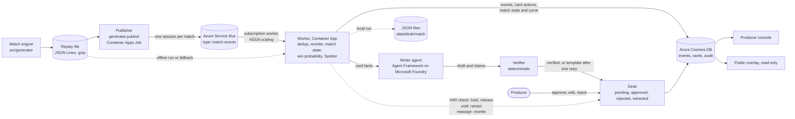

# Watershed

Football's fine margins, measured live and explained to you.

Watershed is an editorial desk for live football broadcasts. It reads a match event feed as it arrives, measures how far each key moment moves the win probability, has an AI agent write the reason in three languages with every number checked against the data, waits for a producer to approve the card before it goes on air, and retracts or rewrites the card when the feed changes its mind (a VAR overturn, a goal credited to another player).

All match data is synthetic, produced by the match engine in this repository. No real match, club, player, footage or logo is used.

<!-- Links added at submission: demo video, live demo, project page. -->

## What exists today

| Part | State | Where |
|---|---|---|
| Synthetic match engine, ground truth, Common Data Format export | Done, tested | `src/generator/` |
| Win-probability model (Skellam, with expected added time) behind a replaceable interface | Done, tested | `src/winprob/` |
| Worker: deduplication, reordering, match state, Spotter, card actions on corrections | Done, tested offline; run against Service Bus and Cosmos DB from a developer machine | `src/worker/match.py`, `spotter.py`, `pipeline.py`, `azure_io.py` |
| Writer agent (Agent Framework on Microsoft Foundry), deterministic Verifier, approval desk with audit trail | Done, tested offline with templates; one measured live run | `src/worker/writer.py`, `desk.py` |
| Desk data contract: cards, match state with the win-probability curve, audit trail, in Cosmos DB or in local JSON files | Done | `docs/contracts.md`, `src/worker/pipeline.py` (`JsonFileSink`, `match_state`) |
| Infrastructure as code (azd and Bicep): Service Bus, Cosmos DB, Container Apps, Container Registry, Log Analytics, Application Insights | Done | `infra/` |
| Worker as a Container App scaled by KEDA on the Service Bus subscription, replay as a Container Apps Job, one managed identity per app, Easy Auth hooks (off until an app registration exists) | Built, not deployed yet | `infra/`, `src/worker/Dockerfile` |
| Pitch figures from the 360 frames, including the 63' offside frame with the offside line and the margin | Built | [`src/web/pitch.py`](src/web/pitch.py), [`docs/img/`](docs/img/) |
| Producer console and public read-only overlay, with a per-IP rate limit and sign-in required for producer actions | Built, not deployed yet (the deployed web app is still the placeholder page) | [`src/web/`](src/web/) |
| CI (tests, Bicep build, secret scanning), Dependabot, cost kill switch tied to the budget | Built; the kill switch is not deployed yet | [`.github/`](.github/), [`infra/killswitch/`](infra/killswitch/) |
| Fictional league history: 50 seasons, 32 clubs with promotion and relegation, about 4,000 players with careers, 19,000 matches with scorers, substitutions and cards | Done, tested | [`src/league/history.py`](src/league/history.py), [`docs/notes/history.md`](docs/notes/history.md) |
| Insight engine: facts that surface live (a substitute's hat-trick, a comeback, a half-time lead lost), ranked by how rare they are in the history, updated or withdrawn as the match goes on, and a stat of the match at full time | Done, tested | [`src/worker/insights.py`](src/worker/insights.py), [`docs/notes/insights.md`](docs/notes/insights.md) |
| Storyline: table, relegation stakes, form and head-to-head before kick-off; what the result changed after it | Done, tested | [`src/worker/storyline.py`](src/worker/storyline.py) |
| Commentary duo: two fictional commentators with complementary voices, in three languages, with a per-match memory against repetition | Done, tested with templates; the model's duo mode has not been run live yet | [`src/worker/duo.py`](src/worker/duo.py), [`docs/notes/duo.md`](docs/notes/duo.md) |
| Match graphics (shot map, goal build-ups, animated set pieces, momentum) and tactical details from the 360 frames | Built | [`src/web/graphics.py`](src/web/graphics.py), [`src/worker/tactics.py`](src/worker/tactics.py) |

## Why it matters

A broadcast graphic that says "United equalise" and stays on screen after VAR rules the goal out is a visible error, live, in front of millions. Feeds correct themselves all the time: goals are voided, scorers are reassigned after a deflection, actions arrive late or twice. A system that writes on-air text from a feed has to treat those corrections as normal traffic, keep a human in charge of what airs, and never let a language model invent a number. Watershed is built around those three constraints:

- **Every number comes from code.** The win probabilities, the swing and the value of a chance are computed deterministically; the model only writes sentences and must declare, for each number, the field it took it from. A deterministic Verifier rejects anything else.
- **A producer decides what airs.** Cards wait in `pending` until approved, edited or rejected; every step is in the audit trail. An auto-approve mode exists for unattended judging and is labelled as such.
- **Corrections are first-class.** A VAR check holds the card, a voided goal retracts it (and records whether it had already aired), a reassigned goal rewrites it as a new version.

## The demo match

Seed 7, story `demo`: Rovers (home) against United, both fictional. The committed replay is `data/replay/demo-0007.jsonl.gz` and its hidden ground truth `data/replay/demo-0007.truth.json`. The win probabilities below are those of the cards, from `python -m worker data/replay/demo-0007.jsonl.gz --writer template --auto-approve` (deterministic, no Azure needed).

| Minute | What happens in the feed | What the desk does | Card figures |
|---|---|---|---|
| 14' | United #9 scores | Goal card | United 30% → 58% to win |
| 31' | United goal credited to #10; at 33' the provider reassigns it to #7 (deflection) | Card rewritten as version 2 with the new scorer | United 60% → 84% |
| 41' | United #5 booked | No card (a yellow card does not move the result probabilities) | |
| 46' | Rovers 0-2 at half-time bring on #20 for #9 | | |
| 52', 57' | #20 scores twice: 2-2 | Two goal cards | Rovers 2% → 10%, then 8% → 32% |
| **63'** | **#20 scores again. The card goes on air. A VAR check starts 15 seconds later; at 64' the goal is ruled out: the through ball found him 0.25 m offside, visible in the freeze frame of the pass** | **Card held during the check, then retracted, flagged as retracted on air** | Rovers 29% → 78%, withdrawn |
| 66' | #20 scores anyway: 3-2 | Goal card | Rovers 28% → 79% |
| 69' | United equalise; VAR rules it out for handball at 70' | Card held, then retracted | United 3% → 20%, withdrawn |
| 72' | Rovers' keeper saves a United shot at 3-2 | Save card that credits the keeper, not the shooter | Rovers kept at 81% instead of 24% if it had gone in |
| 78' | United #5 gets a second yellow | Red-card card | United 2% → 1% with ten men |
| 83' | #20's fourth goal | Goal card | Rovers 91% → 99% |
| 88' | Rovers #10 scores; VAR check; the goal stands | Card held, then released | 99%, never 100% before the final whistle |

Final score 5-2. Against the ground truth, the worker finds all 11 moments that deserve a card, produces no extra card, and takes exactly the three expected card actions (one rewrite, two retractions) (`tests/test_worker.py`). The feed also carries 13 duplicated and 32 delayed messages, which the worker absorbs.

## Story, history and the commentary duo

Every number a viewer sees is anchored to something they can picture. The desk compares the match in progress with 50 fictional seasons of the same league and says what makes it unique, for whom, in seasons rather than in match counts:

| When | What airs (French texts and duo, from the template writer) |
|---|---|
| Before kick-off | "Rovers - United, duel pour le maintien": United are on 34% to go down, 16% with a win, 43% with a defeat. Wren: "Rovers 17e, United 18e. Ce soir, on joue le maintien, Joss." |
| 66' | "Seulement le 6e triplé d'un remplaçant en 50 saisons, le premier depuis Silas Thackeray en 2021/22." |
| 83' | "Premier quadruplé d'un joueur entré en cours de match en 50 saisons de championnat." Joss: "Jamais, Wren. En 50 saisons, aucun joueur entré en cours de match n'avait marqué 4 fois." |
| Full time | "Première défaite de United à l'extérieur après avoir mené à la pause depuis 2020/21, il y a 6 saisons." Stat of the match: the substitute's four goals, ranked first by rarity. |
| Recap | Names both goals VAR ruled out and why ("hors-jeu d'un rien", "main"), and what the result changed: "Rovers passe de la 17e à la 14e place, et son risque de descente de 11 % à 4 %." |

Offside margins stay off air: they are not announced in real broadcasts, and at sprint speed a player covers about 30 cm between two tracking frames, so a centimetre figure would be false precision. The console keeps the measured margin for the producer.

The two commentators, Wren Calder (the emotion and the story) and Joss Ferrier (the number and the detail), are fictional and imitate no real person.

## Architecture



1. The engine writes a match as a feed of JSON messages with a common envelope (schema version, message id, provider sequence number, broadcast clock) and a hidden ground truth.
2. The publisher replays the feed on a Service Bus topic, with the match id as session id so one receiver gets a match in order. Key moments play in real time, the rest faster, so a card can air before the feed corrects it.
3. The worker deduplicates by message id, restores provider order with a 3-second buffer, derives the match state from the set of messages (so a late or repeated message cannot corrupt it), computes the win probability before and after each action, and lets the Spotter decide which moments deserve a card.
4. The Writer agent gets the facts of a card through a function tool and writes it in English, French and Spanish; the Verifier checks every number; the desk stages the card for the producer and writes everything to Cosmos DB, with a match-state document that carries the score, the clock and the win-probability curve (or to JSON files in `data/desk/<match_id>/` when run locally).
5. A VAR check or a correction in the feed becomes an action on the card already proposed or on air.

Details, message types, the temporal contract of corrections, identities and failure modes: [`docs/architecture.md`](docs/architecture.md). What the console and the overlay read: [`docs/contracts.md`](docs/contracts.md).

## Microsoft and Azure technologies

| Technology | Role | Where |
|---|---|---|
| Microsoft Foundry | Hosts the Writer model (`gpt-5.4-nano` deployment, reasoning effort `medium`) | [`src/worker/writer.py`](src/worker/writer.py) (`FoundryWriter`), [`.env.example`](.env.example) |
| Microsoft Agent Framework | The Writer agent, with `get_moment` as a function tool; a spike also runs Spotter, Writer and Verifier as a workflow with a human approval pause (`request_info`) | [`src/worker/writer.py`](src/worker/writer.py), [`spikes/af_trial.py`](spikes/af_trial.py) |
| Azure Service Bus | Transport: topic `match-events`, session-enabled subscription `worker`, dead-letter queue for unreadable messages | [`infra/resources.bicep`](infra/resources.bicep), [`src/generator/publish.py`](src/generator/publish.py), [`src/worker/azure_io.py`](src/worker/azure_io.py) |
| Azure Cosmos DB (NoSQL) | Events, cards and audit trail, partitioned by match id, free tier | [`infra/resources.bicep`](infra/resources.bicep), [`src/worker/azure_io.py`](src/worker/azure_io.py) |
| Azure Container Apps | Hosts the web app (scale 0 to 2); the worker, scaled by a KEDA rule on the Service Bus subscription, and the replay as a Container Apps Job, are in the templates and not deployed yet | [`infra/resources.bicep`](infra/resources.bicep), [`src/web/`](src/web/) |
| Azure Container Registry | Image built remotely by azd, pulled by managed identity | [`infra/resources.bicep`](infra/resources.bicep), [`azure.yaml`](azure.yaml) |
| Log Analytics and Application Insights | Container logs, with a daily ingestion cap | [`infra/resources.bicep`](infra/resources.bicep) |
| Microsoft Entra ID | Every data-plane call uses `DefaultAzureCredential` or a managed identity; Service Bus and Cosmos DB have key authentication disabled | [`infra/resources.bicep`](infra/resources.bicep), [`src/worker/azure_io.py`](src/worker/azure_io.py) |
| Azure Developer CLI (azd) and Bicep | One-command provisioning and deployment | [`azure.yaml`](azure.yaml), [`infra/`](infra/) |

## Synthetic data

The generator is a small match engine, stepped like a state machine: `Clock` (match clock and broadcast clock), `Ball` and `MatchState`, `Laws` (the referee), `ActionModel` (what the player on the ball does), `Shape` (where the 22 players stand), `Director` (the script of the demo), then `Feed` and `TruthRecorder`. The same seed always gives the same feed, byte for byte.

- **Events.** Actions use SPADL-style types, results and body parts, on a 105 x 68 m pitch seen from the acting team. Each one carries a 360-style freeze frame: the position of the 22 players when it happens. Around them, the feed sends match information, periods, added time, substitutions, injuries, VAR checks and corrections.
- **Laws.** Every restart is played from the right spot. Fouls in the box give penalties, a second yellow is a red, offside is judged on the positions in the freeze frame, play stops during a VAR check, and a team makes up to five substitutions in three windows. The added time comes from the time lost, with the Premier League rule since 2024/25: a goal celebration only counts beyond its first 30 seconds.
- **Scripted and unscripted matches.** The demo seed follows a script whose planted moments are still played through the `ActionModel` and the `Laws`. Any other seed has no script: goals come from shots and their xG, and VAR overturns come from offsides the assistant missed.
- **What a real feed suffers.** Latency, late (out-of-order) messages, duplicates, and corrections that void, reassign or update an earlier action, each with a version number and a cause.
- **Ground truth.** The planted moments with the expected action on a card already on air (retract, rewrite or none), every shot with its xG and context, the VAR checks, offsides, cards, corrections and network incidents, so the pipeline can be scored against it.

**Common Data Format.** The generator also writes each match in the [Common Data Format](https://github.com/UnravelSports/common-data-format-validator) (CDF), an open format for football match data (Anzer et al., 2025): `data/replay/cdf/` holds the demo match sheet, metadata, events and tracking frames, with corrections applied. The tests check them against the official CDF schemas, version 0.3.2, in the validator's strictest mode. The live feed keeps its own envelope (sequence numbers, versions, corrections), which CDF, a format for data at rest, does not define.

**Calibration.** The probabilities are hand-tuned, not fitted. Means over 200 unscripted matches, per match and for both teams:

| | Generator | Real reference |
|---|---|---|
| Goals | 3.00 | 2.87, Premier League 2024/25 |
| Expected goals (xG) | 2.97 | 2.89, Premier League 2024/25 (FotMob) |
| Shots | 25.1 | about 26, Premier League 2024/25 (Opta) |
| Shots from outside the box | 33 % | 31.7 %, Premier League 2024/25 (Opta) |
| Passes, throw-ins excluded | 979 | about 893, Premier League 2024/25 (FootballCritic, FotMob) |
| Pass completion | 84 % | 83.7 %, Premier League 2024/25 (FotMob) |
| Pass length | 20.8 m | 20.5 m, our computation on 38 matches of StatsBomb open data, Premier League 2015/16 |
| Fouls | 21.4 | 25, same StatsBomb sample |
| Yellow cards | 3.4 | 4.2, Premier League 2023/24 (Opta) |
| Tackles | 41.1 | 35 (FotMob 2024/25) to 42 (StatsBomb 2015/16) |
| Interceptions | 14.5 | 16 (FotMob 2024/25) to 24 (StatsBomb 2015/16) |
| Added time | 9.4 min (3.4 + 6.0) | 9:44 (2024/25) and 10:35 (2025/26, first seven matchdays): average match length minus 90 minutes (Opta) |

Corners (9.0) and offsides (3.8) are only checked against approximate figures, and the split of added time between the halves is an estimate. `python -m generator --calibrate 200` prints the table; `tests/test_generator.py` checks that each mean stays inside its band (`src/generator/calibration.py`).

## Modelling principles

- **Numbers are computed, never generated.** The win probability, the swing of a goal and the value of a chance come from code and are sent to the model under explicit field names with their meaning (`card_facts` in `src/worker/writer.py`). The model writes words; the Verifier checks that each number it wrote is claimed, matches its field, and keeps its unit.
- **The win-probability model is simple on purpose.** Goals still to come are Poisson at a constant rate per team, so the final goal difference is the current one plus a Skellam variable (`src/winprob/skellam.py`). It sees the score, the time left (with the added time still to come, expected until the board goes up, announced after) and red cards, nothing else, so every figure on air can be explained in one sentence. The red-card factors and team strengths are placeholders, not fitted.
- **The model is replaceable.** The worker depends only on the `WinProbModel` protocol (`src/winprob/model.py`); a lookup table (`src/winprob/table.py`) stands in for the Skellam model in the tests, and a model trained on real data could replace both.
- **A chance is worth its xG times the swing it would have caused.** A late half-chance does not outweigh a real chance, and a save is credited to the keeper (`src/worker/spotter.py`).
- **The generator is richer than the model that reads it.** Scoring rates in the engine depend on the score late in the match and on red cards (`src/generator/actions.py`), while the win-probability model assumes constant rates, so the pipeline is not judged against a copy of its own assumptions.
- **Every planted effect is recorded.** The ground truth lists what the script planted and what each correction should do to a card, so recall, precision and card actions are measured, not asserted.

## Roadmap

- **Fitted parameters.** Fit team strengths and red-card factors on a simulated season, and train a second win-probability model behind the same interface.
- **Season context.** A league of 20 fictional clubs simulated at the score level, so a card can say what a moment means for the title or relegation, with each team's strength drawn independently of the model that reads it.
- **Player-level league.** Line-ups built from player ratings, with injuries, suspensions, rotation and fixture congestion.
- **Managers.** Quality and style, sackings driven by results, successors drawn from a market, no built-in "new manager bounce".
- **Clubs over several seasons.** Wages and revenue, promotion and relegation, ageing squads, recruitment, regression to the mean.

Effects whose evidence is weak (momentum between matches, a built-in new-manager bounce) stay out of the engine by design; a card could mention them only as a belief it attributes to someone.

## Security and cost guards

| Guard | How | Where |
|---|---|---|
| No keys or connection strings for data access | Service Bus and Cosmos DB have local (key) authentication disabled; the code authenticates with `DefaultAzureCredential` (Azure CLI login locally, managed identity in Azure) | `infra/resources.bicep` (`disableLocalAuth: true`), `src/worker/azure_io.py`, `src/generator/publish.py` |
| No registry password | Container Registry admin user disabled; the web app pulls with its managed identity (AcrPull) | `infra/resources.bicep` |
| Foundry without keys in code | The Writer authenticates with a managed identity, or the Azure CLI login locally | `src/worker/writer.py` |
| Roles | One managed identity per app, each with the roles it uses (table in [`docs/architecture.md`](docs/architecture.md#identities-and-roles)): the worker receives on its subscription only, the replay job sends on the topic only; the developer account gets Cosmos DB data access and Service Bus Data Sender and Receiver, only when azd passes its id | `infra/resources.bicep` (worker and replay identities: not deployed yet) |
| Console sign-in | Easy Auth hooks in the templates, off until an app registration exists; the console trusts the signed-in user header only when Easy Auth is on | `infra/`, `src/web/security.py` |
| Output length | 3,000 output tokens at most per model call | `src/worker/writer.py` (`max_tokens`) |
| Model calls per match | 40 at most; beyond that, cards use the fixed template | `src/worker/desk.py` (`max_calls_per_match`) |
| Retries | One retry per card, then the template, so a model failure never blocks a card | `src/worker/writer.py` (`draft`) |
| Log ingestion | Log Analytics daily cap of 0.2 GB, 30-day retention | `infra/resources.bicep` |
| Cosmos DB throughput | Free tier, 1,000 RU/s shared by the three containers; 360 frames excluded from indexing | `infra/resources.bicep` |
| Message lifetime | Service Bus messages expire after one day; a message delivered 10 times or unreadable goes to the dead-letter queue | `infra/resources.bicep`, `src/worker/azure_io.py` |
| Secrets in the repository | `.env` and `.azure/` are git-ignored; `.env.example` holds placeholders only | `.gitignore`, `.env.example` |

Configured on the Azure subscription by hand, outside these templates, and therefore not verifiable from this repository: a rate limit of 20K tokens per minute on the model deployment, key authentication disabled on the Foundry resource, and cost budgets with alerts.

Built but not deployed yet: the console and overlay, the worker Container App, the replay job and the kill switch. A test checks that the public overlay never loads a module that can call the model.

## Run locally

Python 3.12 or later. Nothing below needs Azure.

```
python -m venv .venv
.venv\Scripts\activate            # Windows; source .venv/bin/activate elsewhere
pip install -e ".[azure,agents,web,dev]"
pytest                                                   # about 2 minutes: 200 generated matches are checked
python -m generator --story demo --out data/replay       # regenerate the demo match, its truth and its CDF files
python -m generator --calibrate 200                      # the calibration table above
python -m worker data/replay/demo-0007.jsonl.gz --truth data/replay/demo-0007.truth.json --writer template --auto-approve
python -m worker data/replay/demo-0007.jsonl.gz --writer template --desk-dir data/desk   # cards.json, state.json, audit.jsonl for the console
python -m generator.publish data/replay/demo-0007.jsonl.gz --dry --speed 10    # print the replay with the live pacing
python -m league history --seed 9 --seasons 50 --out data/history                # the 50-season history, about 10 s
python -m worker data/replay/demo-0007.jsonl.gz --writer template --auto-approve --desk-dir data/desk --history data/history/9 --league-seed 9   # with insights and the storyline
python -m worker.recap data/desk/demo-0007                                       # the post-match recap
python -m web.app                                                                # the producer console on http://127.0.0.1:8050 (set DESK_DIR=data/desk, PUBLIC_MODE=0)
```

The `worker` command prints every card in three languages, every card action, and the score against the ground truth. `--writer foundry` uses the Writer agent instead of templates; it needs `FOUNDRY_PROJECT_ENDPOINT` and `FOUNDRY_MODEL` in `.env` (see `.env.example`) and an `az login` account allowed to call the Foundry project.

## Deploy to Azure

```
az login
azd auth login
azd up
```

`azd up` creates a resource group with Service Bus (Standard), Cosmos DB (free tier), a Container Apps environment and the web app, a Container Registry, Log Analytics and Application Insights, and grants your account data access to Service Bus and Cosmos DB. The outputs (`azd env get-values`) give `SERVICE_BUS_FQDN`, `SERVICE_BUS_TOPIC`, `COSMOS_ENDPOINT` and `COSMOS_DATABASE`. The Foundry project and its model deployment are not in the templates: create them in the Foundry portal and copy the endpoint into `.env`.

Once the worker Container App and the replay job are merged, `azd up` deploys them too, and publishing a replay is enough: KEDA starts the worker when the subscription has messages. Until then, from your machine:

```
python -m worker --live --cosmos --writer foundry --auto-approve     # Service Bus in, Cosmos DB out
python -m generator.publish data/replay/demo-0007.jsonl.gz --speed 10
```

A new role assignment can take 5 to 10 minutes to apply; the publisher says so if Service Bus refuses the connection.

## Tests

`pytest` runs about 370 tests in about 3 minutes (some parametrised over 20 matches, the generator checks over 200). The main files:

| File | What it proves |
|---|---|
| `tests/test_generator.py` | Same seed, same feed; the committed demo file is exactly what the generator produces; the demo story (every planted moment, the reassignment, both VAR overturns and the goal that stands, the restarts after them, the second yellow, the save); the 0.25 m offside is visible in the freeze frame; freeze frames have the right players; background chances never outweigh the planted save; envelope, sequence numbers and clocks on 200 matches; the Laws (restarts, second yellow, substitutions, no player acting after leaving) on 200 matches; corrections are typed, versioned and arrive after their action; calibration bands; the replay plays the 63' VAR check in real time; the CDF export passes the official validator in strict mode |
| `tests/test_winprob.py` | Probabilities sum to one; symmetry at equal strengths; a goal raises the scorer's chance and a red card lowers the team's; red cards scale the rates; convergence to the result at the final whistle and never certain before it; added time counted; the Skellam result equals an explicit enumeration of Poisson goals; the lookup table behaves at its edges |
| `tests/test_worker.py` | On the demo: recall 1.0, precision 1.0, the three expected card actions; the 63' card is held then retracted; the save card credits the keeper; shuffled and duplicated messages give the same cards; on 20 unscripted matches every goal gets a card and every corrected one the right action; unreadable messages are refused |
| `tests/test_desk.py` | Every card is written in three languages and verified, Spanish labelled machine-translated; retracted cards were on air and can never be approved again; the reassigned goal is rewritten with the new scorer; no 0% or 100% before the final whistle; producer edits and approvals are audited; the Verifier rejects invented numbers, misused percentages and invalid JSON |

All tests run without Azure and without model calls (the Writer is replaced by the template). On the demo match, one live run with `gpt-5.4-nano` wrote and verified all 12 texts (11 cards and one rewrite) on the first attempt, in 11 to 17 seconds per card for three languages; that run is not part of the test suite.

## Limitations

- **Synthetic data only.** The engine is hand-tuned to real orders of magnitude, not fitted, and the demo match is scripted.
- **Simple win-probability model.** Constant scoring rates, placeholder red-card factors and team strengths; no shots, momentum or substitutions in the model.
- **Console not deployed yet.** The producer console runs locally; the deployed web app is still a placeholder page. The demo can run in auto-approve mode, where a verified card airs without a click.
- **History is score-first.** Each historical match draws its score before placing the events, so a team two goals down does not push harder and a red card does not change the score; club strength decides results, player ratings only who scores. The history has seasons, not dates.
- **Players in the live match and the history are linked only for the demo squads.** For other matches the insight engine has no career facts.
- **One model-backed agent.** The Spotter and the Verifier are deterministic code, by design; only the Writer calls a model. The Agent Framework workflow with a human approval pause exists as a spike, not in the main pipeline.
- **No model fallback in code.** `.env.example` names a fallback deployment (`gpt-5-mini`), but the code does not switch to it: after one failed retry, the fixed template takes over.
- **Worker state lives in memory.** A restarted worker does not reload a match in progress from Cosmos DB, and the live listener stops after 30 seconds without a session.
- **A VAR check flags a card but does not lock it.** A producer can still approve a card under review; only a retracted card is locked.
- **Some roles are broader than a read-only overlay needs.** The web identity has data-contributor rights on Cosmos DB and can send on the Service Bus topic, because the same app is meant to host the producer console; the Container Apps environment reads the Log Analytics shared key at deployment, as Azure requires for that setting.
- **Languages.** English and French are generated natively; Spanish is labelled machine-translated on every card.

## Repository layout

| Path | Content |
|---|---|
| `src/generator/` | Seeded synthetic match engine, feed contract (`feed.py`), CDF export (`cdf.py`), Service Bus publisher (`publish.py`) |
| `src/winprob/` | Win-probability interface, Skellam model, lookup table |
| `src/worker/` | Match state, Spotter, pipeline, Writer and Verifier, desk, Azure adapters |
| `src/web/` | Web app (placeholder today) |
| `data/replay/` | The demo match: feed, ground truth, CDF files |
| `infra/` | Bicep templates used by azd |
| `tests/` | Unit and scenario tests |
| `spikes/` | Technical trials: Agent Framework workflow with human approval, model benchmark report |
| `docs/` | Architecture, data contracts |

## Third-party and open source

| Component | License | Used for |
|---|---|---|
| NumPy, SciPy | BSD-3-Clause | Engine randomness, Skellam distribution |
| Microsoft Agent Framework | MIT | Writer agent |
| Azure SDK for Python (Service Bus, Cosmos DB, Identity) | MIT | Azure access |
| Dash, Gunicorn | MIT | Web app |
| common-data-format-validator | MIT | Test dependency: checks the CDF export against the official schemas |

No third-party code is copied into this repository; see `THIRD_PARTY_NOTICES.md`. The action types follow SPADL (Decroos et al., KDD 2019) and the export follows the Common Data Format (Anzer et al., 2025).

## License

MIT, see `LICENSE`.
