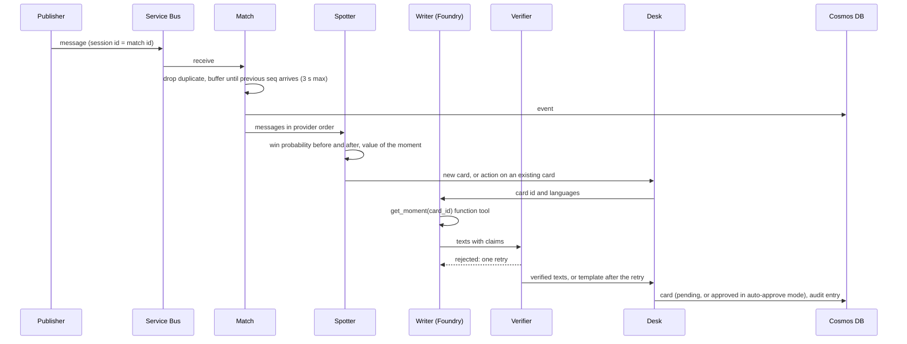
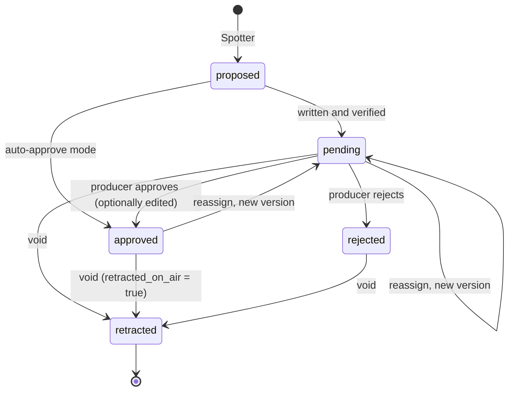

# Architecture

How a message from the match feed becomes a card on air, and what happens when the feed changes its mind. The README gives the overview; this page gives the contracts and the failure behaviour. Every rule below points to the code that implements it.

## Components

| Component | Module | Input | Output | Runs |
|---|---|---|---|---|
| Match engine | `src/generator/engine.py` and the classes it steps (`Laws`, `ActionModel`, `Shape`, `Director`) | Seed, story | Ordered message log | Offline |
| Feed builder | `src/generator/feed.py` (`build_stream`, `TruthRecorder`) | Message log | Feed in arrival order (latency, late messages, duplicates) and hidden ground truth | Offline |
| CDF export | `src/generator/cdf.py` | Feed | Match at rest in the Common Data Format 0.3.2, corrections applied | Offline |
| Publisher | `src/generator/publish.py` | Replay file | Service Bus messages, paced for a live demo | Container Apps Job; developer machine |
| Match | `src/worker/match.py` | Raw messages | Deduplicated messages in provider order; derived state (score, red cards, added time, final whistle) | Worker |
| Win probability | `src/winprob/` | `MatchState` | `WinProb(home, draw, away)` | Worker |
| Spotter | `src/worker/spotter.py` | Ordered messages, match state, model | New cards; card actions (`hold`, `release`, `retract`, `rewrite`) | Worker |
| Writer | `src/worker/writer.py` (`FoundryWriter`, an Agent Framework agent that calls gpt-5.4-nano on Microsoft Foundry; `TemplateWriter`) | Card facts and their meanings | Draft texts and suggested lines with claims, per language | Worker, calls Microsoft Foundry |
| Verifier | `src/worker/writer.py` (`verify`) | Draft, facts | Verification report | Worker |
| Desk | `src/worker/desk.py` | Cards and card actions | Card statuses, audit entries | Worker; producer decisions from the console |
| Insight engine | `src/worker/insights.py`, `insight_rarity.py`, `insight_texts.py` | Match as it stands, league history (`src/league/history.py`) | Insight documents, written from templates | Worker |
| Storyline | `src/worker/storyline.py` | League season (`src/league/season.py`), history | Pre-match storyline, live and post-match season facts | Worker |
| Recap | `src/worker/recap.py` (`RecapWriter`, `RecapTemplateWriter`) | Approved cards, match state, storyline | Recap, supporters' and analyst's texts, verified; the template when the model's drafts fail | Worker, at the final whistle |
| Traces | `src/worker/telemetry.py` | Desk drafts and actions, Agent Framework spans | OpenTelemetry spans in Application Insights, without texts | Worker, when `APPLICATIONINSIGHTS_CONNECTION_STRING` is set |
| Pipeline | `src/worker/pipeline.py` | Messages | Calls the above in order, keeps the win-probability curve, writes to a sink | Worker |
| Match state | `match_state` in `src/worker/pipeline.py` | Match, curve | Score, red cards, clock, final whistle, last sequence number, `wp_timeline` | Worker |
| Sinks | `MemorySink` and `JsonFileSink` in `pipeline.py`, `CosmosSink` in `azure_io.py` | Events, cards, actions, audit, match state | Lists in memory, JSON files in `<desk-dir>/<match_id>/`, or Cosmos DB documents | Worker |
| Web app | `src/web/` | Cards, match state, audit | Producer console (`/`, read only for visitors) and read-only overlay (`/overlay`) | Azure Container Apps |
| Pitch figures | `src/web/pitch.py` | Freeze frames | Pitch figures of the 360 frames, including the 63' offside frame with the offside line; the margin only for the producer | Console, video |

The same `Pipeline` runs on a replay file and on the Service Bus subscription, so every behaviour tested offline is the one that runs live. In Azure, the worker runs as a Container App scaled from zero by a KEDA rule on the Service Bus subscription, and the publisher as a Container Apps Job.

## Data flow

## The feed

The contract is in the docstring of `src/generator/feed.py`. Every message carries the same envelope:

| Field | Meaning |
|---|---|
| `schema_version` | `2.0`; the worker refuses anything else (`SchemaError`) |
| `generator_version` | Version of the engine that produced the feed |
| `match_id` | Also the Service Bus session id and the Cosmos DB partition key |
| `message_id` | Unique; the deduplication key, also set as the Service Bus message id |
| `seq` | Provider order, contiguous from 1 |
| `type` | One of the types below |
| `wall_s` | Broadcast clock, seconds from kick-off |
| `emitted_at_s` | When the provider sends it (`wall_s` plus latency) |
| `period`, `clock_s`, `minute`, `minute_label` | Match clock (all types but `match_info`) |

| Type | Content |
|---|---|
| `match_info` | Teams, line-ups, pre-match expected goals (the model's strengths), referee, pitch frame |
| `period_start`, `period_end`, `added_time`, `full_time` | Clock events; `added_time` carries the minutes shown on the board |
| `action` | One SPADL-style action: `event_id`, `version`, `action_type`, `result`, `bodypart`, start and end in metres, team and player, running score, `shot` (xG, outcome) when it is a shot, `card` when it is a booking, and a 360-style `freeze_frame` of the 22 players |
| `substitution` | Player in, player out |
| `stoppage` | Play stopped, for example for an injury |
| `var_check` | `status` `started`, then `completed` with `decision` `stands` or `overturned`; `target_event_id`, `reason` |
| `correction` | Typed operation on an earlier action: `op` (`void`, `reassign`, `update`), `target_event_id`, `target_version`, `new_version`, `cause`, `changes`, running score after it, and `related_message_id` linking it to the VAR decision |

On Service Bus, each message body is the JSON message; the publisher also sets `session_id`, `message_id`, `content_type` and two application properties, `type` and `schema_version` (`src/generator/publish.py`).

## What the worker stores

Cosmos DB database `watershed`, containers `events`, `cards` and `audit`, all partitioned by `/match_id` (`infra/resources.bicep`). Besides the cards and the match state, the `cards` container holds the insights, the storyline, the recap and the producer feedback, told apart by `type`. Writes are upserts keyed by id, so replaying a message or a card is idempotent (`src/worker/azure_io.py`).

| Container | Document | Id |
|---|---|---|
| `events` | The feed message as received | `message_id` |
| `cards` | The card as it now stands (`type: "card"`): moment, status, version, `under_review`, team, player, score before, `value_pts`, `facts`, then `texts`, `machine_translated`, `writer`, `verification`, `history` | `card-<event_id>` |
| `cards` | The match state (`type: "match_state"`): teams, score, red cards, final whistle, period, clock, last sequence number, and `wp_timeline`, one point per action with the home, draw and away probabilities after it. Rewritten whenever a card or card action is produced, at the end of a period, at full time, on a correction, and every 25 actions | `state-<match_id>` |
| `audit` | Spotter actions (`hold`, `release`, `retract`, `rewrite`, with the cause and the message that triggered them) and desk entries (`written`, `approved`, `edited`, `rejected`, `retracted`, `rewrite_requested`, with who and which version) | Built from the card id, the message id or the step |

Without Cosmos DB, `--desk-dir <dir>` writes the same documents as `<dir>/<match_id>/cards.json`, `state.json`, `insights.json`, `storyline.json`, `recap.json` and `audit.jsonl` (`JsonFileSink`). The console and overlay read these documents; their exact contract is kept in [`contracts.md`](contracts.md).

## When a moment gets a card

The Spotter is deterministic (`src/worker/spotter.py`). The swing between two predictions is half the sum of the absolute changes of the three result probabilities, from 0 to 1 (`swing` in `src/worker/match.py`).

| Moment | Value | Card |
|---|---|---|
| Goal | Swing between before and after | Always |
| Red card or second yellow | Swing caused by going down to ten | Always |
| Saved shot | xG times the swing it would have caused | If the value reaches the threshold (0.08 by default); the card credits the keeper and is created on the keeper's action |
| Other shot (blocked, wide, woodwork) | xG times the swing it would have caused | If the value reaches the threshold |

The win probability before an action uses the state just before its sequence number; after uses the state including it. The state is recomputed from the stored messages each time (`Match.state`), never accumulated.

## Writer and Verifier

1. `card_facts` turns a card into facts with explicit names (`varleigh_wp_before_pct`, `save_value_pts`, `shot_xg_pct`) and a meaning for each field. Win probabilities are clamped to 1 to 99% before the final whistle.
2. The Writer agent (Agent Framework, `FoundryWriter`) is asked for one JSON object with the texts and the suggested lines in each language. It fetches the facts with the `get_moment` function tool and must list, in `claims`, every number it writes with the field it comes from. Output is capped at `FOUNDRY_MAX_TOKENS` (5,000 in the templates, reasoning included; 3,000 when unset), and each call at 45 seconds (`MODEL_TIMEOUT_S`).
3. The Verifier rejects the draft if any number in the text is not claimed, a claim does not match its field, a percentage comes from a field that is not a percentage, a decimal probability appears, a language is missing, a name is not in the facts, a style or on-air rule fails (`LANGUAGE_RULES`, `STRUCTURAL_RULES`), or the JSON is invalid. Over-long texts and reused phrases are reported but do not block.
4. A rejected draft gets one retry, told what was rejected; a reply cut by the token limit is asked once more with twice the room. A timeout, a 429, a network error or a 5xx goes to the template at once. After that, or once the match has used its 40 model calls, the fixed `TemplateWriter` writes the card from the same facts; its output always verifies. Each attempt is traced on the card (`verification.attempts_log`, `fallback_reason`, `writer_config`).

## Card lifecycle

`hold` and `release` do not change the status: they set and clear `under_review`, and are written to the audit trail. A retracted card can never be approved again (`Desk.approve` raises).

## Temporal contract of corrections

A correction is only useful on air if it arrives after the card it corrects and in an order the worker can rely on. The contract has three layers.

**What the feed guarantees** (checked on 200 unscripted matches and the demo by `test_corrections_are_typed_and_ordered` in `tests/test_generator.py`):

- A correction has a higher `seq` than its target action and is emitted after it.
- `target_version` is the current version of the action and `new_version` is one more, so a reader can tell whether it has already applied a correction.
- A VAR overturn produces, at the same broadcast second, the `var_check` completion, an `update` on the action that caused it (for an offside, the pass, with the margin) and a `void` on the goal, all with the running score after the decision.

**What the replay guarantees** (`schedule` in `src/generator/publish.py`, checked by `test_replay_paces_key_moments`):

- Messages from 20 seconds before to 60 seconds after a key moment (goal, red card, shot of 0.2 xG or more, VAR check, void, reassign, update caused by VAR) are sent in real time; the rest of the match runs `--speed` times faster, and half-time takes 10 seconds.
- A correction is sent at least 40 real seconds after the action it corrects (`--min-correction-delay`).
- At speed 10, the void of the 63' goal reaches the topic at least 60 real seconds after the goal, which leaves time to write, approve and air the card before it is retracted.

**What the worker does** (`src/worker/match.py`, `src/worker/spotter.py`, `src/worker/desk.py`):

- Messages are released in `seq` order. In the demo feed, the `void` of the 63' goal is emitted 0.3 seconds before the VAR completion that explains it; the reorder buffer puts the completion first.
- `var_check` started on a goal with a card: `hold`, the card is flagged `under_review` and stays where it is (on air if it was approved).
- `var_check` completed, `stands`: `release`. `overturned`: nothing yet; the card waits for the correction.
- `correction` `void`: `retract`; the audit entry records the previous status and whether the card was on air. The goal no longer counts in any later state, so later cards use the corrected score.
- `correction` `reassign` with a new player: `rewrite`; the card version goes up, the Writer writes it again with the new scorer, and it goes back to `pending` (or straight to air in auto-approve mode).
- `correction` `update` on a card's action without a player change: no card action; the stored action is updated.

The 63' goal of the demo, in feed time:

| Broadcast clock | Message | Card |
|---|---|---|
| goal | `action`, shot, outcome `goal` | Card written and verified; in auto-approve mode it airs at once |
| goal + 15 s | `var_check` started, possible offside | `hold`: under review, still on air |
| goal + 85 s | `var_check` completed, overturned; `correction` update on the through ball (offside, with the measured margin); `correction` void on the goal | `retract`, `retracted_on_air` = true |

## Identities and roles

| Identity | Type | Role | Scope | Why | Source |
|---|---|---|---|---|---|
| Web app | User-assigned managed identity (`id-web-<suffix>`) | AcrPull | Container Registry | Pull the image without a registry password | `infra/resources.bicep` |
| Web app | Same | Cosmos DB Built-in Data Contributor | Cosmos DB account | Read cards, match state and feed for the console, record producer decisions and feedback; more than a read-only overlay needs | `infra/resources.bicep` |
| Worker | User-assigned managed identity (`id-worker-<suffix>`) | AcrPull | Container Registry | Pull the image | `infra/resources.bicep` |
| Worker | Same | Azure Service Bus Data Receiver | Subscription `worker` | Read the feed; also used by the KEDA scale rule | `infra/resources.bicep` |
| Worker | Same | Cosmos DB Built-in Data Contributor | Database `watershed` | Write events, cards, match state, insights, storyline, recap and audit | `infra/resources.bicep` |
| Worker | Same | Foundry User | Foundry account | Call the model for the Writer and the recap writer | `infra/modules/foundry-role.bicep` |
| Replay job | User-assigned managed identity (`id-replay-<suffix>`) | AcrPull | Container Registry | Pull the image | `infra/resources.bicep` |
| Replay job | Same | Azure Service Bus Data Sender | Topic `match-events` | Publish the demo replay | `infra/resources.bicep` |
| Developer (`principalId` from azd) | User | Cosmos DB Built-in Data Contributor | Cosmos DB account | Run the worker locally with `--cosmos`, reset a match | `infra/resources.bicep` |
| Developer | User | Azure Service Bus Data Sender, Azure Service Bus Data Receiver | Service Bus namespace | Publish the replay, run the worker with `--live` | `infra/resources.bicep` |
| Developer | User | Access to the Foundry project | Foundry resource | Run the Writer with `--writer foundry` | Assigned by hand, not in the templates |

The web app has no Service Bus role: the console has no replay button and reads the feed from Cosmos DB.

Console sign-in: Easy Auth (Microsoft Entra provider) on the web app, with an app registration whose client id is `WEB_AUTH_CLIENT_ID`; unauthenticated visitors are allowed and get the console read only, and the app trusts the signed-in user header only when `EASY_AUTH_ENABLED` is true. Without the registration, Easy Auth is off and producer actions are refused in public mode (`src/web/security.py`).

Service Bus and Cosmos DB have local authentication disabled (`disableLocalAuth: true`), so these roles are the only way in. The code never reads a key: `DefaultAzureCredential` in the Service Bus and Cosmos DB clients, `ManagedIdentityCredential` then `AzureCliCredential` for Foundry. Two values that are not data-plane credentials still pass through the templates: the Container Apps environment reads the Log Analytics shared key at deployment (required by the `log-analytics` destination), and the web app and the worker get the Application Insights connection string as an environment variable.

## Failure modes

| Failure | What happens | Where |
|---|---|---|
| Duplicate message | Dropped by `message_id`, counted | `Match.receive` |
| Message out of order | Held until the previous `seq` arrives, at most 3 seconds of feed time; then the gap is skipped | `Match.release` |
| Message later than the buffer | Applied at once; the state is derived from all messages, so the score and red cards stay right | `Match.receive`, `Match.state` |
| Unknown schema version or missing envelope | `SchemaError`; live, the message goes to the dead-letter queue and the session continues | `Match.receive`, `listen` |
| Unreadable JSON or missing field | Dead-lettered, session continues | `listen` |
| Worker stops before completing a message | Service Bus redelivers it; after 10 deliveries it is dead-lettered | `maxDeliveryCount` in `infra/resources.bicep` |
| A match takes longer than the session lock | The lock (1 minute) is renewed automatically for up to 4 hours | `AutoLockRenewer` in `listen` |
| No session with messages for 30 seconds (`--idle`) | The session is released; with `--forever`, as in the container, the worker keeps waiting for the next one, otherwise it stops | `consume`, `listen` |
| Worker restarts mid-match | The match state is in memory and is not reloaded from Cosmos DB; the remaining messages arrive without `match_info`, so no card is produced for that match. Known limitation | `Pipeline._process` |
| Service Bus unavailable | Run the same pipeline on the replay file | `python -m worker <replay>` |
| Model call times out (45 s), gets a 429, a network error or a 5xx | No second call: the template writes at once, and the cause is the card's `fallback_reason` | `model_attempts` |
| Model call raises another error (authentication, a blocked prompt) or returns invalid JSON | Counted as a failed attempt: one retry, then the template | `model_attempts` |
| Reply cut by the token limit (`finish_reason` `length`) | Asked once more with twice the budget; cut again, the template | `model_attempts` |
| Draft fails the Verifier twice | Template; in auto-approve mode the template card airs, since it only uses checked fields. The recap behaves the same way | `model_attempts`, `Desk.write`, `worker.recap` |
| 40 model calls used for the match | Every further card, and the recap, use the template | `Desk.write` |
| Producer tries to approve a retracted card | Refused (`ValueError`) | `Desk.approve` |
| Producer approves during a VAR check | Allowed; the card is flagged `under_review`. Known limitation | `Desk.approve` |
| Correction for a moment without a card | Applied to the match state; no card action | `Spotter.process` |
| Final whistle | The win probability becomes certain only on `full_time`; before it, never 0% or 100% on air | `SkellamWinProb.minutes_left`, `shown` |
| Cosmos DB throttled (1,000 RU/s shared) or briefly unavailable | Retried on 408, 429, 449, 500, 502, 503 and 504 with exponential backoff, jitter and the service's retry-after hint; not load-tested | `with_retry` in `azure_io.py` |
| Logging loop | Log Analytics stops ingesting for the day beyond 0.2 GB | `infra/resources.bicep` |

## Deployment

`azd provision` and `azd deploy` (`azure.yaml`, `infra/main.bicep`, `infra/resources.bicep`) create, in one resource group: Log Analytics (30-day retention, 0.2 GB daily cap) and a workspace-based Application Insights; a Basic Container Registry with the admin user disabled; one identity per app with the roles above; a Standard Service Bus namespace with the topic `match-events` (messages live one day) and the session-enabled subscription `worker` (lock 1 minute, 10 deliveries, dead-lettering on expiry); a Cosmos DB account on the free tier with the database `watershed` (1,000 RU/s shared) and its three containers, the 360 frames excluded from indexing; a Container Apps environment with the web app (0.25 vCPU, 0.5 GiB, 0 to 2 replicas, external ingress, Easy Auth when `WEB_AUTH_CLIENT_ID` is set), the worker (0.5 vCPU, 1 GiB, 0 to 1 replica, no ingress, scaled from zero by a KEDA rule on the `worker` subscription with its managed identity, 15-minute cool-down) and the replay Container Apps Job. The Foundry project and its model deployment are created outside the templates; azd passes their ids to the worker and grants it Foundry User. The order (provision, deploy, provision again for the job) and the reset between two replays are in `docs/notes/infra.md`.
