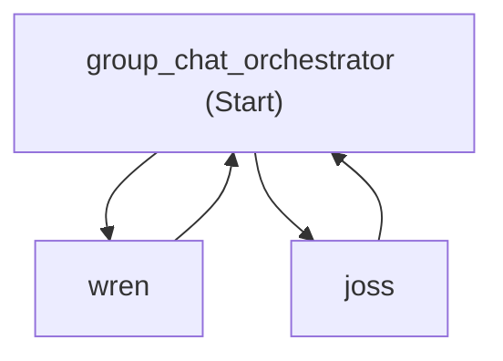

# Agents and MCP: the desk's MCP server, the Writer through it, Wren and Joss as two agents (`worker.mcp_server`, `mcp_writer`, `duo_agents`, `agent_desk`)

Criterion 2 of the judging, "Agentic Design & Innovation" (20% of the mark), asks for creative agentic patterns: "sophisticated agent orchestration, MCP integration or multi-agent collaboration". Without these options two agents call the model, the Writer and the recap agent (Agent Framework, `FoundryChatClient`, one function tool each). The options add three things, each off by default:

1. an MCP server, `watershed-desk`, that serves read-only the desk's verified facts and the league history;
2. the Writer reading its facts through that server;
3. the commentary duo written by two agents, Wren and Joss, orchestrated by an Agent Framework GroupChat, every turn checked by the Verifier, with the template duo as the fallback.

The Verifier stays the authority: every number an agent writes is claimed against a fact computed by code, from the card or from a tool result of the same exchange, and checked deterministically. The duo proposes lines to human commentators; there is no voice.

## Options

| Option | What changes | Imports |
|---|---|---|
| none (default) | nothing: `--writer template` and `--writer foundry` write byte-identical outputs to the desk without these options | none of the modules below |
| `--writer foundry --facts mcp` | `McpWriter`, a `FoundryWriter` whose `get_moment` is served by the MCP server in process; same instructions, message, tool name, description and JSON, same time limit, tool loop, Verifier, retry, template and budget | `mcp_server`, `mcp_writer` |
| `--duo agents` (`--writer template` or `foundry`) | `AgentDesk`: the card as today with the template duo, then Wren and Joss | `mcp_server`, `duo_agents`, `agent_desk` |
| `--duo-dry` | an offline model for Wren and Joss (`DryChatClient`): it speaks the template lines and Joss calls `player_history` once through MCP | |
| `--duo-calls N` (36), `--duo-min-value V` (10), `--duo-deadline S` (30) | the duo's run cap per match, the minimum `value_pts`, the seconds per exchange | |
| `python -m worker.mcp_server --desk-dir D [--history H]` | the same server on stdio over a desk folder, for any MCP host | `mcp_server` |

A subprocess test checks that the default path imports neither `mcp`, `agent_framework_orchestrations` nor any of the four modules.

## Flow

```
Pipeline.handle(m) -> _poll_desk() -> AgentDesk.poll(): applies the finished duos (pipeline thread)
Spotter card -> AgentDesk.write(card, teams)                 (pipeline thread, desk.loop as today)
   eligible: the Writer wrapped in TextsOnly -> draft() -> texts + template duo -> stored at once
   FactRegistry.put_moment(card), put_state(card)             (JSON snapshots under a lock)
   eligible: DuoBudget.reserve(its turns), DuoRunner.submit(DuoSpec) -> thread "duo-agents", its own loop, one job at a time, in order
        run_duo: mcp.Client(MCPServer in process); Wren: get_match_state, get_storyline; Joss: player_history, last_time, head_to_head, club_history
        GroupChat: wren -> joss (-> wren (-> joss)), the order fixed by code; each turn through TurnGate (the Verifier), one retry at most
        -> DuoResult on a queue
McpWriter (--facts mcp): mcp.Client(server) + MCPStdioTool(allowed_tools=["get_moment"]) per call, on desk.loop; the local tool if MCP cannot open
```

A card is eligible when its moment is a goal, a save, a red card or a chance, it is not a goal with no stake (`on_air_priority: low`), and its `value_pts` is at least `--duo-min-value`. It goes to the agents while the duo has at least two free runs in the match (neither taken nor reserved by a job): the Writer writes its texts only (`TextsOnly`), then the job is submitted if the runs of all its turns can be reserved. An eligible card that finds fewer than two free runs keeps the Writer's duo; one that finds two or more but fewer than its turns (four for the table) keeps the template duo, the Writer having been asked for the texts only. Both get a `duo_fallback` entry (`budget`).

The Writer gets no history tool: each tool call is one more model round trip (2 to 8 s in the bench), which the 15 s before the VAR check cannot afford. Through MCP the model sees the same `get_moment` as the local tool, name, description and parameters; only the schema's title differs (`get_momentArguments` against `get_moment_input`), and the result is the same JSON, byte for byte.

## The exchange

`duo_plan` fixes the running order from the card: Wren reacts, Joss brings one number or detail; Wren answers when the moment is worth 30 points or more or the scorer has a hat-trick; when the template duo tells the table (a `season_` claim), Wren asks about the table and Joss answers from the `season_` facts. `verify_duo` then gets two to four alternating lines per language, as for the template.

`GroupChatBuilder(selection_func=job.next_speaker, termination_condition=job.finished)`: no model call orchestrates. The graph, from `WorkflowViz(workflow).to_mermaid()`:



`TurnGate` is an `AgentMiddleware` on each agent. At its turn it turns the partner's accepted line into a user message ("Wren said: ..."), adds the turn prompt (slot, role), runs the agent, reads the tool calls of the run into the job's ledger, and checks the reply. A rejected reply gets one retry with the Verifier's note only (the agent's session carries the rest of the exchange); a second rejection ends the job. Whatever happens, the partner only ever hears an accepted line or "(withheld by the Verifier)", never a rejected draft.

The ledger holds the facts of this exchange's tool results, with their meaning, tool, arguments and subject. A tool value that differs from a fact of the card or of an earlier result is set aside as a conflict; a field of the card is never replaced. The ledger belongs to one job: Wren may quote what Joss looked up, never a fact from another card.

The Verifier for the agents is the Writer's duo check (claims, units, the team named with a probability, French and Spanish rules) plus four rules:

| Rule | Why | Fallback reason |
|---|---|---|
| a capitalised word that is not in the facts or tool results, nor Wren, Joss or VAR, is an error (a warning for the Writer), at the start of a sentence too, after `:` and after `¡ ¿`, where only a common word of the language may stand (`COMMON_WORDS`) | an agent with tools has more room to invent a player, a club or a pundit, and the Writer's check (`names_ok`) leaves out the first word of a sentence | `names` |
| a number word needs a whole-number fact of that value, or the word in a text fact ("six-pointer"): cardinals and ordinals (three, trois, tres, seventeen, quinze, tercer, tercera, twelfth), a number in several words read whole (dix-sept is 17, also vingt et un, treinta y dos), and what a player's goals in a match are called (hat-trick, coup du chapeau, brace, doublé, triplé, doblete, triplete, póker) | digits are claimed, words were not | `numbers` |
| the table turn claims at least one `season_` field | the question was about the table | `table` |
| the first sentence holding a claimed tool number names its subject (a player's surname is enough) | "He had 6 goals" said of the wrong player would pass the number check | `subject` |
| a `_count` field of a tool (times in the whole history, a number of matches in effect) and `last_time`'s league-wide `<kind>_seasons_with_one` are off air: a claim on one is a bad claim, and they back no number word (`off_air_field`) | rarity is told in seasons, anchored on a club or a player; the agents may read those fields, never tell them | `numbers` |

One, two, ten and eleven (and their French and Spanish forms), first and second, are left out of the number words on purpose: "ten men", "le onze de départ", "the second half". A number in several words ("one-two", the pass) that does not read as one number is checked word by word.

`COMMON_WORDS` is a list per language of the words a spoken line starts with (articles, pronouns, conjunctions, adverbs, exclamations: about 460 in English, 300 in French, 270 in Spanish), plus every word of the templates and the number words. Two limits: a name that is also a common word ("Best", "Bravo") still passes at the start of a sentence, and a model will start some lines with a word the list misses, which costs a retry or the template. The `rejected` entries of `duo_trace` give the words refused: after the first real run, the list (`COMMON_WORDS_TEXT`) is where to add the false refusals.

When every turn passed, the whole exchange is checked again against the card's facts and the tool facts the lines rely on (`tool_facts`: claimed, holding a name a line says, or backing a number word), the check the desk repeats before applying it.

## Applying a duo

`AgentDesk.poll()` runs on the pipeline's thread, at each message and at `flush`. It drops a result for an older version of the card, reads the producer's decisions back from the store (status, texts, history, as the pipeline does before a feed change), refuses a card retracted or rejected meanwhile, checks the lines once more, then replaces `duo`, sets `duo_writer: agents:<model>` and `duo_trace`, records the lines in the match's `PhraseMemory` and writes a `duo_written` audit entry. Otherwise the template duo stays and `duo_fallback` gives the reason: `numbers`, `style`, `names`, `table`, `subject`, `format`, `final`, `budget`, `timeout`, `stale`, `cancelled`, `retracted`, `rejected`, `error:<type>`. The texts are never touched and `duo_ruling` (VAR) stays template-only. A retraction or a rewrite cancels the card's job; the rewritten version gets its own.

## Budget

- **Writer**: unchanged. `Desk(max_calls_per_match=40)` counts the Writer's attempts (`Draft.attempts`), and `draft(calls_left)` caps each card at two. MCP adds no run; `TextsOnly` only shortens the reply of an eligible card (no duo in it), and passes the Writer's trace through (`last_call`, `writer_config`, the larger `max_tokens` of a retry after a truncated reply). The card's `verification.fallback_reason` then reads `duo_not_supported`, as for any writer that takes no duo: the template duo is the one the agents replace.
- **Duo**: a cap of its own, `--duo-calls`, 36 agent runs per match. A turn or a retry is one run, its tool round trip included (two model requests at most per run: `max_iterations` 2, `max_function_calls` 1). `DuoBudget.take` counts each run before the model is called. A job reserves the runs of its turns when it is submitted (`DuoBudget.reserve`), takes them turn by turn, and gives back what it did not take when it ends, whatever the end (verified, refused, timed out, cancelled, stale). A job that cannot reserve its turns is not submitted (`budget`): a job waiting behind others never stops halfway for the budget. A retry takes a free run, never one another job reserved; when there is none, the turn fails with its own reason (`numbers`, `names`...).
- **Why a separate cap**: the demo already uses 28 to 34 of the Writer's 40, and the duo, which has a verified fallback, would starve the cards. Ceiling: 40 + 36 = 76 runs per match.

The dry run of the demo with the command below (`--duo-dry`, history and storyline on, `--desk-dir`) gives 9 jobs and 27 runs, the estimate of the design, the same over three runs on this machine:

| Minute | Plan | Runs |
|---|---|---|
| 14' | react, detail, ask the table, the table | 4 |
| 31' v1, then v2 (rewritten) | react, detail | 2 + 2 |
| 52' | react, detail | 2 |
| 57' | four turns (table) | 4 |
| 63' (ruled out after) | four turns (table) | 4 |
| 66' | four turns (table) | 4 |
| 69' (ruled out after) | react, detail | 2 |
| 72' save (57 points) | react, detail, answer | 3 |
| 78', 83', 88' | not eligible: value 5, value 8, no stake | 0 |

These counts are not a fixed result. In a replay the pipeline does not wait for the duo: a card that VAR rules out keeps the agents' duo when it was applied before the ruling (63' and 69' in the command's run), and otherwise ends `cancelled` (the job was stopped) or `retracted` (it finished after the ruling). In process, with a `MemorySink`, the pipeline goes faster and 63' ends one way or another from one run to the next, so the jobs and runs vary. An applied duo also enters the match's `PhraseMemory` at the next message, and the template variants picked for the next cards can change with that timing. Without `--duo agents`, the worker stays deterministic.

With a model, each retry adds a run, two at most per job. Cost, inferred from `data/bench/report.md` (gpt-5-mini: 0.0021 $ per card at medium effort, 0.0006 $ at minimal): a duo run, about 2.5 k tokens in and 0.4 to 0.8 k out at low effort, costs 0.001 to 0.002 $, under 0.08 $ per match.

## Latency

- **The card**: the same path as today. Offline, with a scripted model, a `draft()` through MCP takes 8 to 13 ms against 5 to 9 ms with the local tool (MCP adds 3 to 5 ms), and a few tens of ms for the first call of the process; the model's 11 to 17 s are untouched. The card is stored before anything is handed to the duo, and the hand-over takes microseconds.
- **The duo**: off the critical path, on its own thread and loop. One or two requests per turn, 2 to 8 s each in the bench: 5 to 25 s per exchange. The deadline (30 s) runs from the start of the job; live, a job that waited more than 20 s in the queue is dropped (`stale`). The result is applied at the pipeline's next message, or at the flush after a quiet session. In a replay, the end of the run waits for the queued jobs. Live with `--forever`, a duo that finishes after the last flush of a match waits for the next session's messages.
- **Applying a duo**: on the pipeline's thread. With Cosmos DB (`ThreadedSink`), it first reads the card back from the store for the producer's decisions, which drains the pending writes: tens to hundreds of ms per duo, not measured.
- **Start-up**: `HistoryFacts.build` reads the history once on the main thread, about 1.2 to 1.6 s for 50 seasons on this machine, and shares its `HistoryView` with the insight engine. The first `last_time` call computes every occurrence once (about 0.1 s); the other tools answer in under 10 ms. The stdio server lists its tools after about 1.1 s, 2.5 s with the 50-season history to read.

## Running it

Offline, no Azure, no cost:

    python -m worker data/replay/demo-0007.jsonl.gz --writer template --duo agents --duo-dry --history data/history/9 --league-seed 9 --desk-dir data/desk

Each card prints who wrote its duo (`duo agents:dry: wren, joss (player_history), wren, joss: 4 runs, 0.2 s`), and the run ends with `duo agents (dry): 9 written, {} template, 27 of 36 runs`.

With the model (`az login`, `FOUNDRY_PROJECT_ENDPOINT` and `FOUNDRY_MODEL` in `.env`; `FOUNDRY_DUO_MODEL` and `FOUNDRY_DUO_REASONING_EFFORT`, default `low`, are optional), first on one card with the template Writer, so that the duo alone calls the model, 6 runs at most: `--duo-min-value 50 --duo-calls 6` leaves the agents the 66' goal and the 69' one, which VAR rules out soon after; with a model, still waiting behind 66', it is likely to end `cancelled` (the dry run applies it first).

    python -m worker data/replay/demo-0007.jsonl.gz --writer template --duo agents --duo-min-value 50 --duo-calls 6 --history data/history/9 --league-seed 9 --desk-dir data/desk

The two limits only bound the duo: the same command with `--writer foundry --facts mcp` also runs the Writer and the recap agent on Foundry, up to their own 40 runs per match. Then without the limits; with the Writer through MCP, the run ends with `Writer facts: N through MCP, 0 local` and the duo line.

## Not verified against the real API

Every test runs on scripted or dry chat clients. Not seen yet with the Responses API: the partner's lines sent as user messages, the retry over a service-stored history (`previous_response_id`), reasoning items in the session, and the JSON in three languages from a model at low effort. The template keeps the card safe meanwhile: a first real pass on one card says whether the prompts hold.

- The fallback rate is unknown: the Verifier is stricter for the agents than for the Writer, the first word of a sentence included. Proposed threshold: more than half of the exchanges falling back, or exchanges over 30 s, and `--duo agents` stays off for the demo.
- Quality: for an eligible card the Writer writes the texts only. When the agents fall back, the card keeps the template duo, not the Writer's duo it would have had without `--duo agents`: a loss to measure at the first real run.
- Quota: Wren and Joss use `FOUNDRY_DUO_MODEL`, or the Writer's `FOUNDRY_MODEL` when it is not set; their requests then go to the Writer's deployment at the same time as the Writer's. A 429 and the SDK's retries could stretch the Writer's 11 to 17 s: give the duo a deployment of its own, or check the deployment's tokens per minute, before a real match. "The duo never delays the card" holds for the CPU and the thread, not for a shared quota.
- The duo changes under the producer's eyes, 10 to 25 s after the card, possibly after approval. The audit says so and the texts do not move. Still to decide: keep the template duo on a card a producer already approved, or show the change in the console.
- A right number can be used with a misleading meaning (a rank called "second" from a count): the Verifier does not see it. Text facts widen it: a number claimed from a text fact only has to appear in it, and a number word only has to be a word of one (`claim_ok`, `unbacked_number_words`), so a minute of `match_goal_log`, a score of a `last_*_match` or the "six" of "six-pointer" can back a number anywhere in the exchange. Human review stays.
- The cap of 36 was set on one match, the demo.
- The image deployed to Azure has neither the `agentic` extra nor `data/history`: the duo by agents runs locally only, and the video should be recorded locally with `--history`.
- mcp and Agent Framework move fast: the `agentic` extra pins the versions tested (agent-framework-core 1.23.0, agent-framework-foundry 1.15.0, agent-framework-orchestrations 1.4.0, mcp 2.3.0) for the week of the judging. The worker image does not install it (`src/worker/Dockerfile` installs `azure` and `agents` under `constraints.txt`), so mcp's web stack (starlette, uvicorn, sse-starlette, pyjwt) stays out of the deployed image.

## Reviewing the French and Spanish lines

The agents write each line natively in each language; the first real lines need a reader for:

- French: no article before a club ("Varleigh", "pour Yarnford", never "le Varleigh", "l'Yarnford", "d'Yarnford"); a no-break space before % : ; ? !; "points" only for a change in a chance of winning; no "swing", no "momentum"; "avant cette saison" for a history number.
- Spanish: the article before a club ("el Varleigh", "del Yarnford", "al Town"); "opciones de ganar", "puntos"; no "swing", no "momentum"; "antes de esta temporada".
- Both: number words that match a fact ("trois", "tres"), a tic at most once per match, rarity in seasons ("depuis 2015/16", "hace 6 temporadas"), never a number of matches.
